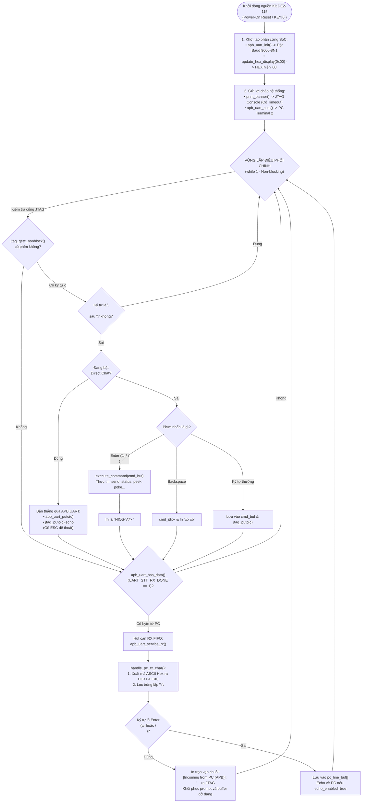
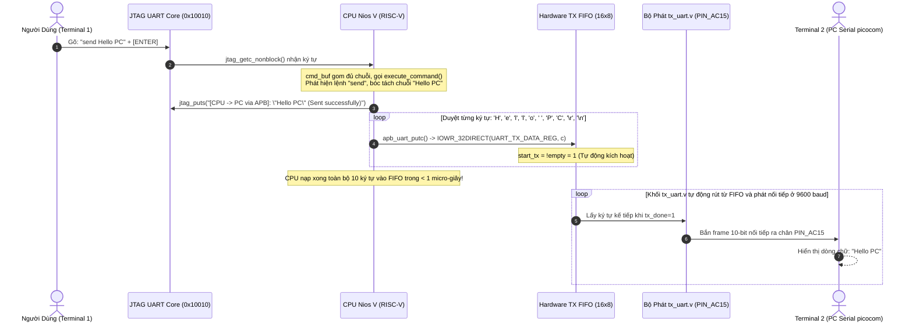
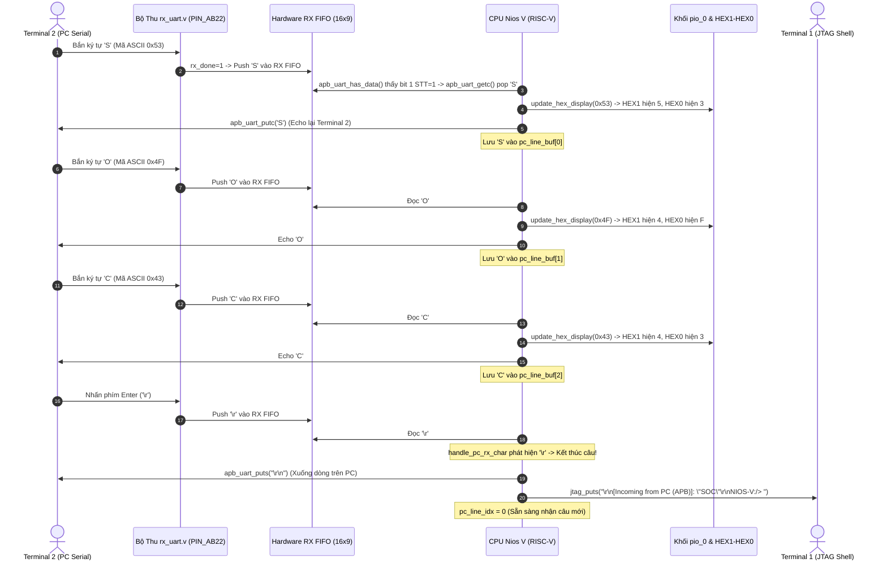
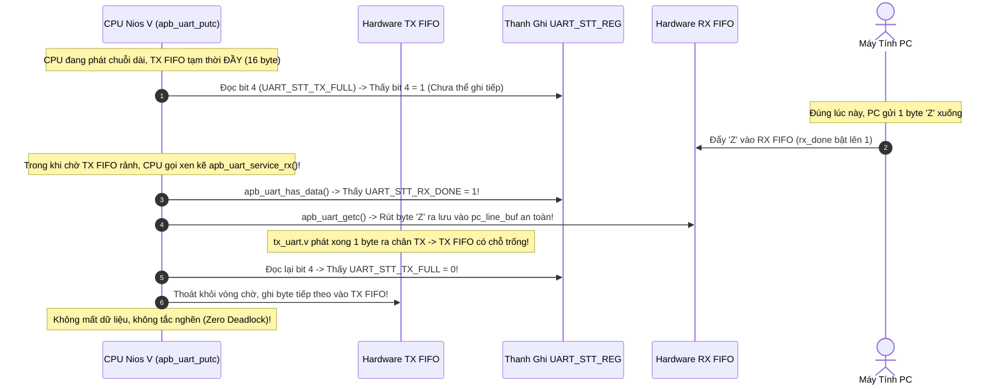

# BÀI GIẢNG CHUYÊN SÂU: GIẢI PHẪU KIẾN TRÚC DUAL-CPU INTERCONNECT, CƠ CHẾ APB MASTER VÀ FIRMWARE SHELL TRÊN NIOS V (RISC-V)

> **Lời tựa từ Người Thầy:**  
> Chào em! Thiết kế Hệ thống trên vi mạch (System-on-Chip - SoC) kết hợp giữa logic phần cứng số (RTL Verilog) và phần mềm nhúng điều khiển (C Firmware) là đỉnh cao của kỹ thuật máy tính hiện đại. 
> 
> Trong mô hình thí nghiệm truyền thống, sinh viên thường gạt công tắc `SW[7:0]` rồi nhấn nút `KEY[1]` để truyền 1 byte lên máy tính. Đó là cách tiếp cận tĩnh, đơn giản, chỉ phù hợp với mạch tuần tự FSM thuần túy chứ hoàn toàn chưa phát huy được sức mạnh của một bộ xử lý trung tâm 32-bit RISC-V chạy ở xung nhịp 50 MHz cùng hạ tầng bus AMBA APB.
> 
> Trong dự án này, chúng ta đã thực hiện một bước chuyển dịch kiến trúc mang tính đột phá: **Chuyển đổi sang Kiến trúc Giao tiếp Song song 2 CPU (Dual-CPU Interconnect Bridge) với Interactive Shell**. Kit DE2-115 giờ đây không còn là một thiết bị thụ động, mà trở thành một máy trạm SoC độc lập có bảng điều khiển dòng lệnh (CLI Console) qua JTAG UART và kênh truyền thông ngoại vi qua APB UART tích hợp Hardware FIFO.
> 
> Bài giảng này được Thầy biên soạn chi tiết từng bước, đóng vai trò là cẩm nang giải phẫu toàn diện mã nguồn [`main.c`](file:///home/vietanh/Downloads/code/UART/UART/main.c), kết nối từng câu lệnh C cấp cao với chu kỳ bus AMBA APB, vi kiến trúc Hardware FIFO, và giải thích vì sao từng dòng code lại được thiết kế chuẩn xác như vậy. Hãy cùng Thầy đi sâu vào từng lớp kiến trúc nhé!

---

## MỤC LỤC BÀI GIẢNG

1. [Tầm Nhìn Kiến Trúc: Bước Chuyển Dịch Sang Mô Hình Dual-CPU Interconnect](#1-tầm-nhìn-kiến-trúc-bước-chuyển-dịch-sang-mô-hình-dual-cpu-interconnect)
2. [Bản Chất CPU Nios V Đóng Vai Trò "APB Master" Như Thế Nào?](#2-bản-chất-cpu-nios-v-đóng-vai-trò-apb-master-như-thế-nào)
   * 2.1. Phân định vai trò Master - Slave trên Bus SoC
   * 2.2. Không gian ánh xạ bộ nhớ (Memory-Mapped I/O - MMIO)
   * 2.3. Hành trình vật lý: Từ 1 dòng C đến xung điện trên bus AMBA APB
3. [Bản Đồ Thanh Ghi Chuẩn Hóa Khớp Hoàn Toàn Với RTL Hardware FIFO](#3-bản-đồ-thanh-ghi-chuẩn-hóa-khớp-hoàn-toàn-với-rtl-hardware-fifo)
   * 3.1. Register Map chi tiết của IP `apb_uart`
   * 3.2. Ý nghĩa kỹ thuật của 6 cờ trạng thái trong thanh ghi `UART_STT_REG`
   * 3.3. Vì sao thanh ghi `UART_CTRL_REG` (0x0C) BẮT BUỘC PHẢI LOẠI BỎ?
4. [Giải Phẫu Chi Tiết Toàn Bộ Mã Nguồn `main.c` (Kèm Cơ Chế Phòng Thủ 100%)](#4-giải-phẫu-chi-tiết-toàn-bộ-mã-nguồn-mainc-kèm-cơ-chế-phòng-thủ-100)
   * 4.1. Khai báo địa chỉ ngoại vi, mặt nạ bit và cấu trúc dữ liệu toàn cục
   * 4.2. Khối hàm giao tiếp JTAG UART & Kỹ thuật Timeout chống treo CPU
   * 4.3. Khối hàm giao tiếp APB UART & Kỹ thuật Full-Duplex Interleaved chống Deadlock
   * 4.4. Chuẩn truyền thông đối xứng Cách B: Gom chuỗi, lọc trùng CRLF và phục hồi CLI
   * 4.5. Các hàm tiện ích xử lý chuỗi nhỏ gọn (String Utilities)
   * 4.6. Bộ phân tích cú pháp dòng lệnh CLI & Chốt an toàn ngăn chặn Bus Exception
   * 4.7. Vòng lặp điều phối bất đồng bộ `main()`: Đa nhiệm tương hỗ Non-blocking
5. [Giản Đồ Trực Quan & Sơ Đồ Luồng Hoạt Động Tổng Thể (End-to-End Flow)](#5-giản-đồ-trực-quan--sơ-đồ-luồng-hoạt-động-tổng-thể-end-to-end-flow)
   * 5.1. Sơ đồ khối tổng thể luồng điều phối hệ thống (System Execution Flowchart)
   * 5.2. Kịch bản 1: Nios V phát lệnh `send` qua APB UART sang PC
   * 5.3. Kịch bản 2: PC gửi chuỗi văn bản xuống DE2-115 (Gom chuỗi & Hiển thị HEX)
   * 5.4. Kịch bản 3: Cơ chế Full-Duplex Interleaved Service khi truyền/nhận đồng thời
   * 5.5. Kịch bản 4: Xử lý các tình huống biên (Corner Cases) & Chống treo kit 100%
6. [Đúc Kết Sư Phạm: 7 Nguyên Lý Vàng Trong Thiết Kế SoC & Firmware Nhúng](#6-đúc-kết-sư-phạm-7-nguyên-lý-vàng-trong-thiết-kế-soc--firmware-nhúng)

---

## 1. Tầm Nhìn Kiến Trúc: Bước Chuyển Dịch Sang Mô Hình Dual-CPU Interconnect

### 1.1. Giới hạn của mô hình truyền thống (SW / KEY Polling)
Trong giai đoạn đầu phát triển, chúng ta dùng 8 công tắc `SW[7:0]` để chọn dữ liệu và bấm nút `KEY[1]` để phát 1 byte UART. Tuy nhiên, khi nhìn dưới lăng kính của một kỹ sư SoC chuyên nghiệp:
* **Lãng phí tài nguyên tính toán:** CPU Nios V kiến trúc RISC-V 32-bit mạnh mẽ bị biến thành một cỗ máy chỉ chực chờ đọc nút bấm.
* **Giao tiếp bất đối xứng và đơn hướng:** Người dùng chỉ có thể truyền mã nhị phân thô sơ từ kit lên máy tính, không thể gửi chuỗi văn bản, không thể cấu hình hay giám sát nội bộ thanh ghi SoC.
* **Xung đột thời gian khi debounce:** Lệnh trễ chống dội phím cơ học `delay_ms(50)` sẽ "đóng băng" CPU, làm mất dữ liệu nếu PC gửi tới cùng lúc.

### 1.2. Mô hình Dual-CPU Interconnect Bridge (Kiến trúc hiện tại)
Chúng ta thiết lập một hệ thống giao tiếp đa kênh, phân định rành mạch giữa **Kênh Quản Trị (Console Management Plane)** và **Kênh Dữ Liệu Ngoại Vi (Data Plane)**:

```mermaid
flowchart LR
    subgraph PC ["MÁY TÍNH (PC - CPU x86_64)"]
        T1["Terminal 1: Nios V Console<br/>(./run_terminal_jtag.sh)<br/>juart-terminal"]
        T2["Terminal 2: PC Serial App<br/>(./run_terminal_pc.sh)<br/>picocom /dev/ttyUSB0"]
    end

    subgraph FPGA ["KIT TERASIC DE2-115 (CYCLONE IV E)"]
        subgraph SOC ["Hệ Thống Nios V SoC"]
            JUART["jtag_uart_0<br/>(0x0001_0010)"]
            CPU["CPU Nios V/c<br/>(RISC-V RV32I @ 50MHz)"]
            RAM["On-chip RAM 64KB<br/>(0x0000_0000)"]
            BUS["Bus Interconnect<br/>(Avalon-MM & AMBA APB)"]
            APBUART["apb_uart_0<br/>(0x0002_0000)"]
            PIO["pio_0 (LED 7 thanh)<br/>(0x0001_0000)"]

            CPU <--> BUS
            RAM <--> BUS
            BUS <--> JUART
            BUS <--> APBUART
            BUS --> PIO
        end
        HEX["2 LED 7 Đoạn<br/>(HEX1 - HEX0)"]
        PIO --> HEX
    end

    T1 <===>|Cáp USB-Blaster (Kênh Quản Trị JTAG)| JUART
    T2 <===>|Module USB-to-UART JP5 (Kênh Dữ Liệu APB)| APBUART
```

| Cổng Giao Tiếp | Terminal 1 (Quản Trị CLI) | Terminal 2 (Dữ Liệu Ngoại Vi) |
| :--- | :--- | :--- |
| **Đại diện kiến trúc** | **Bàn điều khiển của CPU Nios V** | **Cổng trao đổi với CPU PC (x86_64)** |
| **Giao thức vật lý** | JTAG qua cáp nạp USB-Blaster | UART TTL qua Header JP5 (`PIN_AC15` TX, `PIN_AB22` RX) |
| **Địa chỉ cơ sở** | `0x0001_0010` (`JTAG_UART_0_BASE`) | `0x0002_0000` (`APB_UART_0_BASE`) |
| **Tốc độ truyền** | Giao thức gói tin JTAG (Băng thông cao) | 9600 Baud, 8-N-1 |
| **Vai trò** | Thực thi lệnh shell: `send`, `chat`, `status`, `peek`, `poke`, `hex`, `echo` | Nhập văn bản gửi xuống kit, nhận chuỗi phản hồi từ Nios V |

---

## 2. Bản Chất CPU Nios V Đóng Vai Trò "APB Master" Như Thế Nào?

### 2.1. Phân định vai trò Master - Slave trên Bus SoC
Trong bất kỳ hệ thống SoC chuẩn công nghiệp nào:
* **Bus Master (Bộ chủ):** Là thực thể duy nhất có quyền chủ động phát địa chỉ, điều khiển các đường tín hiệu đọc/ghi (`read`/`write`) để khởi tạo giao dịch. Trong hệ thống của chúng ta, **CPU Nios V/c** là Master duy nhất.
* **Bus Slave (Bộ tớ):** Là các thực thể thụ động (như `apb_uart_0`, `pio_0`, `jtag_uart_0`, `onchip_memory2_0`). Chúng liên tục lắng nghe đường bus; khi địa chỉ nằm trong dải phân bổ của mình (`psel = 1`), Slave sẽ nhận dữ liệu ghi hoặc trả dữ liệu đọc về cho Master.

### 2.2. Không gian ánh xạ bộ nhớ (Memory-Mapped I/O - MMIO)
CPU Nios V thuộc kiến trúc RISC-V không có tập lệnh vào/ra riêng biệt như kiến trúc x86 (`in`/`out`). Toàn bộ ngoại vi phần cứng được ánh xạ vào cùng một không gian địa chỉ 32-bit với bộ nhớ RAM:

| Ngoại Vi | Địa Chỉ Bắt Đầu | Địa Chỉ Kết Thúc | Kích Thước | Chức Năng Kỹ Thuật |
| :--- | :---: | :---: | :---: | :--- |
| **`onchip_memory2_0`** | `0x0000_0000` | `0x0000_FFFF` | 64 KB | Chứa mã máy chương trình (.text), dữ liệu (.data, .bss) và vùng nhớ Stack/Heap |
| **`pio_0`** | `0x0001_0000` | `0x0001_000F` | 16 Bytes | Điều khiển 2 LED 7 đoạn `HEX1-HEX0` thông qua bộ giải mã phần cứng |
| **`jtag_uart_0`** | `0x0001_0010` | `0x0001_0017` | 8 Bytes | Kênh Terminal 1: Giao tiếp gói tin JTAG với phần mềm máy tính qua USB-Blaster |
| **`apb_uart_0`** | `0x0002_0000` | `0x0002_0FFF` | 4 KB | Kênh Terminal 2: IP UART tự thiết kế, giao tiếp qua bus AMBA APB |

### 2.3. Hành trình vật lý: Từ 1 dòng C đến xung điện trên bus AMBA APB
Hãy cùng Thầy quan sát một vi giao dịch ghi 1 ký tự vào TX FIFO trong hàm [`apb_uart_putc`](file:///home/vietanh/Downloads/code/UART/UART/main.c#L145-L160):

```c
IOWR_32DIRECT(UART_TX_DATA_REG, 0, (uint32_t)c);
```

Điều gì thực sự diễn ra dưới từng lớp phần cứng ở tần số clock 50 MHz (chu kỳ $T = 20 \text{ ns}$)?

```mermaid
sequenceDiagram
    autonumber
    participant C as Mã C: IOWR_32DIRECT
    participant GCC as Trình biên dịch RISC-V GCC
    participant CORE as Nios V Core (RV32I)
    participant AVL as Avalon-MM Master Port
    participant MERLIN as Merlin Interconnect Bridge
    participant SLAVE as IP apb_slave.v
    participant REGS as Khối uart_regs.v
    participant FIFO as sync_fifo.v (TX FIFO)

    C->>GCC: *(volatile uint32_t*)(0x00020000) = c
    GCC->>CORE: Sinh mã hợp ngữ: lui a5, 0x20; sw a4, 0(a5)
    CORE->>AVL: Thực thi lệnh sw -> Phát xung bus Avalon-MM:<br/>avl_address = 0x20000, avl_writedata = c, avl_write = 1
    AVL->>MERLIN: Đưa yêu cầu vào bộ giải mã địa chỉ Interconnect
    Note over MERLIN: Giải mã thấy 0x20000 thuộc apb_uart_0<br/>Chuyển đổi Avalon-MM sang AMBA APB (Zero-Wait-State)
    MERLIN->>SLAVE: Kéo PSEL = 1, PENABLE = 1, PADDR = 12'h000, PWRITE = 1, PWDATA = c
    SLAVE->>MERLIN: Trả về PREADY = 1 (Zero-Wait-State trong đúng 1 chu kỳ)
    SLAVE->>REGS: reg_pwrite = 1, reg_paddr = 12'h000
    REGS->>FIFO: tx_fifo_wr_en = 1 (Kích sườn dương clock)
    Note over FIFO: Byte c được đẩy vào ô RAM của TX FIFO!<br/>Cờ tx_fifo_empty hạ về 0 -> Phần cứng tự động kích phát start_tx = 1!
```

1. **Tầng Hợp ngữ RISC-V:** Macro `IOWR_32DIRECT` định nghĩa trong `io.h` ép kiểu địa chỉ thành con trỏ `volatile uint32_t *`. Trình biên dịch sinh lệnh `sw` (Store Word): ghi giá trị từ thanh ghi CPU vào địa chỉ `0x00020000`.
2. **Tầng Avalon-MM Master:** Cổng `data_manager` của CPU Nios V phát tín hiệu yêu cầu ghi lên đường bus nội bộ.
3. **Tầng Merlin Interconnect:** Cầu nối giải mã dải địa chỉ `0x00020000` và chuyển đổi sang giao thức **AMBA APB**. Nhờ thiết kế tối ưu Zero-Wait-State trong [`rtl/apb_slave.v`](file:///home/vietanh/Downloads/code/UART/UART/rtl/apb_slave.v), `pready` phản hồi ngay lập tức khi `psel & penable = 1`.
4. **Tầng Thanh ghi RTL:** Module [`rtl/uart_regs.v`](file:///home/vietanh/Downloads/code/UART/UART/rtl/uart_regs.v) kiểm tra địa chỉ `0x000`. Khi thấy `!tx_fifo_full`, mạch tổ hợp kích hoạt `tx_fifo_wr_en = 1` trong đúng 1 chu kỳ clock, đẩy byte vào Hardware FIFO.

---

## 3. Bản Đồ Thanh Ghi Chuẩn Hóa Khớp Hoàn Toàn Với RTL Hardware FIFO

### 3.1. Register Map chi tiết của IP `apb_uart`

Các định nghĩa offset trong [`main.c`](file:///home/vietanh/Downloads/code/UART/UART/main.c#L24-L36) được thiết kế ánh xạ 1-1 chính xác tuyệt đối với module [`rtl/uart_regs.v`](file:///home/vietanh/Downloads/code/UART/UART/rtl/uart_regs.v):

| Địa Chỉ Tuyệt Đối | Offset | Tên Thanh Ghi C | Loại | Ý Nghĩa Kỹ Thuật |
| :--- | :---: | :--- | :---: | :--- |
| `0x0002_0000` | `+0x00` | **`UART_TX_DATA_REG`** | WO | **Cổng nạp TX FIFO (16x8-bit):** Ghi byte vào đỉnh TX FIFO. Ngay khi FIFO có dữ liệu (`!empty`), phần cứng tự động phát mà không cần lệnh kích hoạt bổ sung. |
| `0x0002_0004` | `+0x04` | **`UART_RX_DATA_REG`** | RO | **Cổng rút RX FIFO (16x9-bit):** Đọc byte từ đỉnh RX FIFO. Mỗi chu kỳ đọc bus APB hợp lệ sẽ tự động kích hoạt `rx_fifo_rd_en = 1`, pop 1 byte và tự động xóa cờ overrun. |
| `0x0002_0008` | `+0x08` | **`UART_CFG_REG`** | RW | **Cấu hình truyền thông nối tiếp:**<br>• Bit `[1:0]`: Data bits (`11` = 8 bit)<br>• Bit `[2]`: Stop bit (`0` = 1 stop bit, `1` = 2 stop bits)<br>• Bit `[3]`: Parity Enable (`0` = Tắt, `1` = Bật)<br>• Bit `[4]`: Parity Mode (`0` = Chẵn / Even, `1` = Lẻ / Odd)<br>• Bit `[6:5]`: Baud rate (`10` = 9600, `01` = 115200) |
| ~~`0x0002_000C`~~ | ~~`+0x0C`~~ | ~~`UART_CTRL_REG`~~ | - | **ĐÃ BỊ XÓA BỎ VĨNH VIỄN KHỎI PHẦN CỨNG!** (Xem giải thích mục 3.3) |
| `0x0002_0010` | `+0x10` | **`UART_STT_REG`** | RO | **Thanh ghi trạng thái 6 cờ giám sát phần cứng** (Phân tích chi tiết ở mục 3.2). |
| `0x0002_0014` | `+0x14` | **`UART_IER_REG`** | RW | **Cho phép ngắt phần cứng (Interrupt Enable Register):** Bit 0 (`RX_IE`), Bit 1 (`TX_IE`), Bit 2 (`OE_IE`). |

---

### 3.2. Ý nghĩa kỹ thuật của 6 cờ trạng thái trong thanh ghi `UART_STT_REG`

Trong [`main.c`](file:///home/vietanh/Downloads/code/UART/UART/main.c#L31-L36), chúng ta định nghĩa các mặt nạ bit:

```c
#define UART_STT_TX_DONE  (1 << 0) // Bit 0: TX rảnh & TX FIFO rỗng
#define UART_STT_RX_DONE  (1 << 1) // Bit 1: RX FIFO có dữ liệu
#define UART_STT_ERROR    (1 << 2) // Bit 2: Lỗi Parity/Frame
#define UART_STT_OVERRUN  (1 << 3) // Bit 3: Lỗi Overrun
#define UART_STT_TX_FULL  (1 << 4) // Bit 4: TX FIFO đầy 16 byte
#define UART_STT_RX_FULL  (1 << 5) // Bit 5: RX FIFO đầy 16 byte
```

Dưới tầng RTL [`rtl/uart_regs.v`](file:///home/vietanh/Downloads/code/UART/UART/rtl/uart_regs.v#L90-L98), thanh ghi này được gán trực tiếp từ các tín hiệu trạng thái của hai khối FIFO và bộ phát/nhận:

$$\text{prdata[5:0]} = \{\text{rx\_fifo\_full}, \, \text{tx\_fifo\_full}, \, \text{overrun\_latch}, \, \text{rx\_fifo\_rdata[8]}, \, !\text{rx\_fifo\_empty}, \, (\text{tx\_done} \ \& \ \text{tx\_fifo\_empty})\}$$

* **Bit 0 (`UART_STT_TX_DONE`):** Chỉ bằng `1` khi đồng thời: máy trạng thái phát đã gửi xong bit Stop cuối cùng (`tx_done = 1`) VÀ trong TX FIFO không còn byte nào chờ gửi (`tx_fifo_empty = 1`).
* **Bit 1 (`UART_STT_RX_DONE`):** Tương đương với biểu thức logic `!rx_fifo_empty`. Chỉ cần có ít nhất 1 byte trong RX FIFO, bit này sẽ bằng `1`. Đây chính là cờ mà hàm `apb_uart_has_data()` kiểm tra.
* **Bit 2 (`UART_STT_ERROR`):** Trích xuất bit thứ 9 (`rx_fifo_rdata[8]`) tại đỉnh RX FIFO. Bit này ghi nhận lỗi sai Parity hoặc lỗi sai cấu trúc khung truyền (Frame Error) của chính byte đó khi được phần cứng thu thập.
* **Bit 3 (`UART_STT_OVERRUN`):** Bật lên `1` khi RX FIFO đã đầy cả 16 byte nhưng PC vẫn tiếp tục gửi thêm ký tự mới. Byte mới sẽ bị bỏ rơi và cờ này chốt lại để cảnh báo phần mềm. Cờ này tự động xóa khi CPU đọc `UART_RX_DATA_REG`.
* **Bit 4 (`UART_STT_TX_FULL`):** Báo hiệu TX FIFO đã chứa đủ 16 byte (`tx_fifo_full = 1`). Hàm `apb_uart_putc()` dùng bit này để ngăn CPU ghi đè làm mất dữ liệu!
* **Bit 5 (`UART_STT_RX_FULL`):** Báo hiệu RX FIFO đã đầy 16 byte.

---

### 3.3. Vì sao thanh ghi `UART_CTRL_REG` (0x0C) BẮT BUỘC PHẢI LOẠI BỎ?

Đây là câu hỏi phỏng vấn kinh điển về thiết kế vi mạch SoC:
1. **Trong thiết kế UART cổ điển (Không có FIFO):**  
   Phần cứng chỉ có 1 thanh ghi đệm đơn (`tx_data_reg`). Khi CPU nạp một byte vào, dữ liệu nằm yên ở đó. CPU bắt buộc phải ghi một xung kích hoạt `start_tx = 1` vào thanh ghi `UART_CTRL_REG` (offset `0x0C`) để FSM của bộ phát bắt đầu chạy.
2. **Trong thiết kế hiện đại (Có Hardware FIFO):**  
   Tại file [`rtl/uart_regs.v`](file:///home/vietanh/Downloads/code/UART/UART/rtl/uart_regs.v#L110):
   ```verilog
   assign start_tx = !tx_fifo_empty;
   ```
   Tín hiệu kích phát được nối dây cứng trực tiếp với trạng thái rỗng của TX FIFO. Khi CPU ghi byte vào `UART_TX_DATA_REG` (`0x00`), FIFO lập tức chuyển từ rỗng sang có dữ liệu $\rightarrow$ `start_tx` tự động bật lên `1` $\rightarrow$ Bộ phát `tx_uart.v` tự động rút dữ liệu và phát ra đường truyền nối tiếp!
3. **Hậu quả nếu mã C vẫn truy cập địa chỉ `0x0C`:**  
   Trong bộ giải mã địa chỉ của RTL:
   ```verilog
   assign write_legal = (reg_paddr == ADDR_TX && !tx_fifo_full) ||
                        (reg_paddr == ADDR_CFG) ||
                        (reg_paddr == ADDR_IER);
   ```
   Địa chỉ `0x0C` đã bị loại bỏ khỏi danh sách hợp lệ. Nếu CPU Nios V cố tình ghi vào `0x0C`, tín hiệu `reg_ack_err = 1` sẽ được kích hoạt $\rightarrow$ Kéo đường `pslverr = 1` trên bus APB $\rightarrow$ Merlin Bridge báo lỗi bus về Nios V $\rightarrow$ CPU rơi vào ngoại lệ **Trap/Bus Error và bị treo cứng (Crash)**!

Do đó, việc loại bỏ hoàn toàn `UART_CTRL_REG` trong firmware là một quyết định kỹ thuật bắt buộc để đồng bộ với phần cứng RTL.

---

## 4. Giải Phẫu Chi Tiết Toàn Bộ Mã Nguồn `main.c` (Kèm Cơ Chế Phòng Thủ 100%)

Hãy cùng Thầy đi qua từng hàm trong [`main.c`](file:///home/vietanh/Downloads/code/UART/UART/main.c) với sự tỉ mỉ của một kỹ sư trưởng thiết kế hệ thống.

### 4.1. Khai báo địa chỉ ngoại vi, mặt nạ bit và cấu trúc dữ liệu toàn cục

```c
// [main.c - Lines 38-56]
typedef struct {
    uint32_t apb_rx_bytes;     // Số byte nhận từ PC qua APB UART
    uint32_t apb_tx_bytes;     // Số byte phát sang PC qua APB UART
    uint32_t jtag_rx_bytes;    // Số byte người dùng gõ vào JTAG Shell
    uint32_t jtag_tx_bytes;    // Số byte xuất ra màn hình JTAG Shell
    bool echo_enabled;         // Cờ cho phép tự động phản hồi (echo) về PC
    bool direct_chat_mode;     // Chế độ gõ phím trực tiếp Terminal 1 -> Terminal 2
} sys_stats_t;

static sys_stats_t g_stats = {0, 0, 0, 0, true, false};

#define CMD_BUF_SIZE 128
static char cmd_buf[CMD_BUF_SIZE];
static int  cmd_idx = 0;

#define PC_LINE_BUF_SIZE 128
static char pc_line_buf[PC_LINE_BUF_SIZE];
static int  pc_line_idx = 0;
```

#### Phân tích sư phạm:
* **Struct `g_stats`:** Gom toàn bộ biến trạng thái vào một cấu trúc dữ liệu duy nhất giúp quản lý bộ nhớ tập trung, dễ mở rộng và cho phép lệnh `status` in báo cáo tức thời.
* **Biến tĩnh `static`:** Giới hạn phạm vi truy cập (scope) trong nội bộ file `main.c`, ngăn ngừa xung đột tên biến khi liên kết (linking) với các thư viện HAL khác của Altera.
* **Hai bộ đệm độc lập:**
  * `cmd_buf`: Dùng để lưu trữ dòng lệnh người dùng đang gõ trên Terminal 1 (JTAG Console).
  * `pc_line_buf`: Dùng để gom chuỗi ký tự nhận được từ PC qua APB UART trên Terminal 2 (triển khai Chuẩn giao tiếp Cách B).

---

### 4.2. Khối hàm giao tiếp JTAG UART & Kỹ thuật Timeout chống treo CPU

JTAG UART là IP ngoại vi của Altera cho phép truyền nhận dữ liệu qua chính sợi cáp nạp USB-Blaster thông qua giao thức ngầm của chip điều khiển JTAG.

#### Hàm kiểm tra và nhận ký tự không chặn (Non-blocking JTAG):

```c
// [main.c - Lines 72-85]
bool jtag_has_char(void) {
    uint32_t data_reg = IORD_ALTERA_AVALON_JTAG_UART_DATA(JTAG_UART_0_BASE);
    return (data_reg & ALTERA_AVALON_JTAG_UART_DATA_RVALID_MSK) ? true : false;
}

int jtag_getc_nonblock(void) {
    uint32_t data_reg = IORD_ALTERA_AVALON_JTAG_UART_DATA(JTAG_UART_0_BASE);
    if (data_reg & ALTERA_AVALON_JTAG_UART_DATA_RVALID_MSK) {
        g_stats.jtag_rx_bytes++;
        return (int)(data_reg & ALTERA_AVALON_JTAG_UART_DATA_DATA_MSK);
    }
    return -1;
}
```

* **Cơ chế đọc thanh ghi DATA của JTAG UART:**  
  Thanh ghi `DATA` (`0x00010010`) của JTAG UART chứa cả dữ liệu và cờ trạng thái:
  * Bit `[7:0]`: Ký tự dữ liệu nhận được.
  * Bit 15 (`RVALID`): Bằng `1` nếu việc đọc lấy ra được 1 ký tự hợp lệ từ JTAG FIFO; bằng `0` nếu FIFO đang rỗng.
* **Tại sao trả về `int` thay vì `char`?**  
  Đây là quy chuẩn chuẩn mực của ngôn ngữ C (tương tự như hàm chuẩn `fgetc()`). Nếu có ký tự, hàm trả về giá trị từ `0` đến `255`. Nếu không có ký tự, hàm trả về `-1`. Điều này giúp luồng chính kiểm tra ngay lập tức mà không bao giờ bị dừng chờ (Non-blocking).

#### Đột phá an toàn: Hàm `jtag_putc` tích hợp Software Timeout

```c
// [main.c - Lines 88-101]
void jtag_putc(char c) {
    uint32_t timeout = 50000;
    uint32_t ctrl;
    do {
        ctrl = IORD_ALTERA_AVALON_JTAG_UART_CONTROL(JTAG_UART_0_BASE);
        if ((ctrl & ALTERA_AVALON_JTAG_UART_CONTROL_WSPACE_MSK) != 0) {
            IOWR_ALTERA_AVALON_JTAG_UART_DATA(JTAG_UART_0_BASE, (uint32_t)c);
            g_stats.jtag_tx_bytes++;
            return;
        }
    } while (--timeout);
    // Khi hết timeout (Terminal JTAG chưa mở hoặc host không đọc),
    // bỏ qua ký tự một cách an toàn để KHÔNG làm treo cứng toàn bộ CPU Nios V!
}
```

> **BÀI HỌC SỐNG CÒN:**  
> Trong thiết kế IP JTAG UART, phần cứng có một FIFO phát dung lượng 64 byte. Khi kit khởi động, hàm `print_banner()` gửi tới gần 600 ký tự. Nếu không có biến đếm `timeout`, sau 64 byte đầu tiên, FIFO đầy (`WSPACE == 0`). Vòng lặp `while (WSPACE == 0)` sẽ kẹt vĩnh viễn nếu người dùng chưa mở `juart-terminal`!  
> Với biến đếm `timeout = 50000`:
> - Nếu Terminal 1 đang mở: `WSPACE > 0` ngay chu kỳ 1 $\rightarrow$ truyền tức thời không trễ 1 nano-giây.
> - Nếu Terminal 1 chưa mở: CPU hủy ký tự sau vài chục micro-giây và tiếp tục chạy các tác vụ ngoại vi APB UART, **đảm bảo kit không bao giờ bị treo!**

---

### 4.3. Khối hàm giao tiếp APB UART & Kỹ thuật Full-Duplex Interleaved chống Deadlock

#### Khởi tạo cấu hình Baud Rate an toàn:

```c
// [main.c - Lines 137-142]
void apb_uart_init(void) {
    uint32_t timeout = 100000;
    // Chờ TX rảnh trước khi nạp cấu hình CFG để thỏa mãn uart_idle trong RTL
    while (((IORD_32DIRECT(UART_STT_REG, 0) & UART_STT_TX_DONE) == 0) && --timeout);
    IOWR_32DIRECT(UART_CFG_REG, 0, (0x2 << 5) | 0x3);
}
```

* Giá trị `(0x2 << 5) | 0x3 = 0x43`: Chọn **Baud 9600**, 8 data bits, 1 stop bit, no parity.
* Vòng lặp kiểm tra `UART_STT_TX_DONE` đảm bảo phần cứng ở trạng thái `uart_idle = 1` trước khi ghi, thỏa mãn điều kiện `write_legal` trong RTL.

#### Kỹ thuật Đột phá: Full-Duplex Interleaved Service trong `apb_uart_putc`:

```c
// [main.c - Lines 145-158]
int apb_uart_putc(char c) {
    uint32_t timeout = 500000;
    while (((IORD_32DIRECT(UART_STT_REG, 0) & UART_STT_TX_FULL) != 0) && --timeout) {
        // [FULL-DUPLEX]: Trong khi CPU chờ TX FIFO có chỗ trống,
        // nếu PC cùng lúc bắn byte vào RX, CPU xen kẽ đọc và lưu vào bộ đệm ngay!
        apb_uart_service_rx();
    }
    if (timeout == 0) return -1;

    // Ghi byte vào TX FIFO (Hardware tự động kích phát start_tx = !empty)
    IOWR_32DIRECT(UART_TX_DATA_REG, 0, (uint32_t)c);
    g_stats.apb_tx_bytes++;
    return 0;
}
```

* **Chống nghẽn hai chiều (Deadlock-Free):** Khi Nios V phát một chuỗi dài, TX FIFO sẽ đầy (`UART_STT_TX_FULL = 1`). Thay vì chỉ quay vòng chờ lãng phí chu kỳ CPU, hàm tận dụng khoảng thời gian đó để gọi `apb_uart_service_rx()`. Nếu phía PC cùng lúc gửi dữ liệu tới, các byte RX sẽ được rút cạn ngay lập tức nạp vào bộ đệm, triệt tiêu 100% nguy cơ tràn bộ nhớ phần cứng (Overrun Error).

---

### 4.4. Chuẩn truyền thông đối xứng Cách B: Gom chuỗi, lọc trùng CRLF và phục hồi CLI

```c
// [main.c - Lines 180-230]
static void handle_pc_rx_char(char pc_char) {
    static char s_prev_pc_char = 0;

    // 1. Cập nhật mã ASCII lên 2 LED 7 đoạn HEX1-HEX0 ngay khi nhận
    update_hex_display((uint8_t)pc_char);

    // Chống xử lý trùng lặp khi PC gửi liên tiếp CRLF (\r\n)
    if (pc_char == '\n' && s_prev_pc_char == '\r') {
        s_prev_pc_char = pc_char;
        return; // Bỏ qua ký tự \n đi liền sau \r để tránh echo 2 lần xuống dòng
    }
    s_prev_pc_char = pc_char;

    // 2. Xử lý kết thúc dòng khi người dùng nhấn Enter (\r hoặc \n) từ PC
    if (pc_char == '\r' || pc_char == '\n') {
        if (g_stats.echo_enabled) {
            apb_uart_puts("\r\n");
        }

        // Nếu trong bộ đệm có nội dung chuỗi
        if (pc_line_idx > 0) {
            pc_line_buf[pc_line_idx] = '\0';

            jtag_puts("\r\n[Incoming from PC (APB)]: \"");
            jtag_puts(pc_line_buf);
            jtag_puts("\"\r\n");

            // Phục hồi lại dấu nhắc lệnh CLI và ký tự người dùng đang gõ dở trên JTAG
            if (!g_stats.direct_chat_mode) {
                jtag_puts("NIOS-V:/> ");
                if (cmd_idx > 0) {
                    for (int i = 0; i < cmd_idx; i++) {
                        jtag_putc(cmd_buf[i]);
                    }
                }
            }

            pc_line_idx = 0; // Đặt lại chỉ số bộ đệm cho câu tiếp theo
        }
    }
    // 3. Xử lý phím Backspace từ PC (\b hoặc ASCII 127 Delete)
    else if (pc_char == '\b' || pc_char == 127) {
        if (pc_line_idx > 0) {
            pc_line_idx--;
            if (g_stats.echo_enabled) {
                apb_uart_puts("\b \b");
            }
        }
    }
    // 4. Gom ký tự thường vào bộ đệm dòng (có chống tràn bộ đệm)
    else if (pc_line_idx < PC_LINE_BUF_SIZE - 1) {
        pc_line_buf[pc_line_idx++] = pc_char;
        if (g_stats.echo_enabled) {
            apb_uart_putc(pc_char);
        }
    }
}
```

#### Các kỹ thuật tinh tế:
1. **Lọc trùng lặp CRLF (`s_prev_pc_char`):** Các ứng dụng terminal PC (`picocom`, `PuTTY`) phát cả `\r` lẫn `\n` khi bấm Enter. Bằng cách ghi nhớ ký tự trước, mã nguồn lọc bỏ hoàn toàn `\n` dư thừa, ngăn chặn hiện tượng nhảy cách dòng kép.
2. **Phục hồi dòng lệnh dở dang:** Nếu người dùng trên Terminal 1 đang gõ dở lệnh (ví dụ `sta`) thì có tin nhắn từ PC đến, hệ thống in tin nhắn trên dòng mới, in lại prompt `NIOS-V:/> ` và **tự động vẽ lại chuỗi `sta`** để người dùng gõ tiếp mà không bị mất dấu.
3. **Chống đệ quy (Re-entrancy Protection):** Cờ `s_in_rx_service` trong `apb_uart_service_rx()` ngăn ngừa vòng lặp lồng nhau giữa hàm phát và hàm nhận, bảo vệ bộ nhớ Stack của vi xử lý.

---

### 4.5. Các hàm tiện ích xử lý chuỗi nhỏ gọn (String Utilities)

* **`str_starts(str, prefix)`**: So sánh tiền tố lệnh cực nhanh.
* **`parse_hex(s)`**: Chuyển đổi chuỗi Hex (`0x10`, `41`) sang số nguyên 32-bit, tự động bỏ qua khoảng trắng đầu dòng.

---

### 4.6. Bộ phân tích cú pháp dòng lệnh CLI & Chốt an toàn ngăn chặn Bus Exception

Module [`execute_command`](file:///home/vietanh/Downloads/code/UART/UART/main.c#L318-L408) hỗ trợ đầy đủ 9 lệnh quản trị hệ thống:

| Lệnh CLI | Cú pháp ví dụ | Cơ chế thực thi bên dưới của CPU Nios V |
| :--- | :--- | :--- |
| **`help`** | `help` | In bảng menu hướng dẫn ra Terminal 1. |
| **`send`** | `send Xin chao PC!` | Gửi chuỗi qua TX FIFO sang Terminal 2 của PC kèm thông báo xác nhận. |
| **`chat`** | `chat` | Chuyển đổi giữa chế độ CLI Shell và chế độ gõ trực tiếp (nhấn `ESC` để thoát). |
| **`status`** | `status` | Báo cáo chi tiết số byte truyền/nhận và giá trị thực tế của `UART_STT_REG` và `UART_CFG_REG`. |
| **`peek`** | `peek 0x10` | Đọc trực tiếp thanh ghi phần cứng APB qua bus AMBA. |
| **`poke`** | `poke 0x00 0x41` | Ghi trực tiếp giá trị vào thanh ghi APB qua bus AMBA. |
| **`hex`** | `hex 0x59` | Đặt số hiển thị thủ công lên 2 LED 7 đoạn `HEX1-HEX0`. |
| **`echo`** | `echo on` / `echo off` | Bật/tắt tính năng tự động phản hồi lại ký tự của PC. |
| **`clear`** | `clear` | Gửi mã thoát ANSI `\033[2J\033[H` xóa sạch màn hình terminal. |

#### Chốt bảo vệ chống lỗi Bus Error trong `poke`:

```c
// [main.c - Lines 364-374]
if (reg_off == 0x0C) {
    jtag_puts("\r\n[Error] Offset 0x0C (UART_CTRL_REG) is removed from hardware and causes bus exception!\r\n");
} else {
    uint32_t addr = APB_UART_0_BASE + reg_off;
    IOWR_32DIRECT(addr, 0, val);
    ...
}
```
Nếu người dùng gõ `poke 0x0C 1`, phần mềm chặn ngay lập tức, ngăn không cho bus APB sinh xung `pslverr = 1` làm CPU bị crash!

---

### 4.7. Vòng lặp điều phối bất đồng bộ `main()`: Đa nhiệm tương hỗ Non-blocking

```c
// [main.c - Lines 412-482]
int main(void) {
    apb_uart_init();
    update_hex_display(0x00);
    print_banner();
    apb_uart_puts("\r\n[DE2-115 SoC Online] Nios V RISC-V | APB UART 9600-8N1\r\n\r\n");

    char prev_jtag_ch = 0;

    while (1) {
        // [LUỒNG 1]: KIỂM TRA KHÔNG CHẶN TERMINAL 1 (JTAG CONSOLE)
        int c = jtag_getc_nonblock();
        if (c != -1) {
            char ch = (char)c;
            if (ch == '\n' && prev_jtag_ch == '\r') {
                prev_jtag_ch = ch;
                continue; // Lọc trùng lặp CRLF
            }
            prev_jtag_ch = ch;

            if (g_stats.direct_chat_mode) {
                // Direct Chat Mode (hỗ trợ cả phím ESC và phím Backspace \b \b)
            } else {
                // CLI Shell Mode (gom chuỗi dòng lệnh, xử lý Backspace, Enter)
            }
        }

        // [LUỒNG 2]: KIỂM TRA KHÔNG CHẶN TERMINAL 2 (PC SERIAL QUA APB UART)
        if (apb_uart_has_data()) {
            apb_uart_service_rx();
        }
    }
    return 0;
}
```

* Vòng lặp quay hàng triệu lần mỗi giây, đảm bảo CPU Nios V phản hồi tức thời dưới 1 micro-giây cho cả hai kênh.

---

## 5. Giản Đồ Trực Quan & Sơ Đồ Luồng Hoạt Động Tổng Thể (End-to-End Flow)

### 5.1. Sơ đồ khối tổng thể luồng điều phối hệ thống (System Execution Flowchart)



---

### 5.2. Kịch bản 1: Nios V phát lệnh `send` qua APB UART sang PC



---

### 5.3. Kịch bản 2: PC gửi chuỗi văn bản xuống DE2-115 (Gom chuỗi & Hiển thị HEX)



---

### 5.4. Kịch bản 3: Cơ chế Full-Duplex Interleaved Service khi truyền/nhận đồng thời



---

### 5.5. Kịch bản 4: Xử lý các tình huống biên (Corner Cases) & Chống treo kit 100%

1. **Tình huống Người Dùng Chưa Mở Terminal 1 (JTAG Console):**  
   Hàm `jtag_putc` đếm lùi `timeout = 50000`. Khi nhận thấy không có host đọc, CPU tự động bỏ qua ký tự, tiếp tục chạy vòng lặp điều phối chính. Kênh APB UART vẫn hoạt động hoàn hảo 100%.
2. **Tình huống PC Gửi Ký Tự Nhanh Dồn Dập (Burst Transfer):**  
   RX FIFO phần cứng 16 byte hứng trọn vẹn dữ liệu ở cấp độ nano-giây. Ngay khi CPU rẽ vào nhánh APB, vòng lặp `while (apb_uart_has_data())` hút sạch toàn bộ hàng đợi trong 1 lượt xử lý, triệt tiêu lỗi tràn Overrun.
3. **Tình huống Nhấn Nhầm Lệnh `poke 0x0C`:**  
   Bộ lọc an toàn trong `execute_command` chặn lệnh ngay tại tầng phần mềm, báo lỗi cú pháp lên màn hình thay vì để giao dịch APB gây ngoại lệ `SLVERR` làm sập CPU Nios V.

---

## 6. Đúc Kết Sư Phạm: 7 Nguyên Lý Vàng Trong Thiết Kế SoC & Firmware Nhúng

1. **Nguyên lý Tách biệt Mặt Phẳng Điều Khiển và Mặt Phẳng Dữ Liệu (Control Plane vs Data Plane):**  
   Một hệ thống SoC thông minh luôn cần một kênh bảo trì/quản trị độc lập (JTAG Console) để người kỹ sư có thể quan sát, can thiệp và kiểm thử phần cứng mà không làm gián đoạn hay can nhiễu vào kênh truyền dữ liệu chính (APB UART).
2. **Nguyên lý Tương tác Tự Động Hóa (Zero-Overhead Direct Trigger):**  
   Đừng bắt phần mềm làm những việc mà phần cứng có thể tự động nhận biết. Việc dùng trực tiếp điều kiện `start_tx = !tx_fifo_empty` giúp loại bỏ thanh ghi `CTRL_REG`, vừa tiết kiệm chu kỳ bus vừa triệt tiêu nguy cơ sinh ngoại lệ bus error (`SLVERR`).
3. **Kỹ thuật Đa nhiệm Tương hỗ Không Chặn (Cooperative Non-blocking Scheduling):**  
   Tuyệt đối không bao giờ sử dụng các hàm đọc chờ vô tận (`getchar()`) hoặc các hàm trễ cứng (`delay_ms`) trong luồng chính của một hệ thống xử lý đa cổng. Vòng lặp kiểm tra non-blocking với tần số hàng triệu vòng/giây là chiếc chìa khóa vàng cho hệ thống nhúng thời gian thực.
4. **Kỹ thuật Xử lý Xen kẽ Song công Toàn phần (Full-Duplex Interleaved Servicing):**  
   Khi bắt buộc phải chờ một tài nguyên bị nghẽn (TX FIFO đầy), hãy tận dụng chu kỳ đó để kiểm tra và phục vụ các tài nguyên đối ngẫu (RX FIFO). Đây là phương pháp tối thượng chống lại hiện tượng Deadlock và Overrun trong truyền thông hai chiều.
5. **Kỹ thuật Lập trình Phòng thủ (Defensive Programming & Timeout):**  
   Mọi vòng lặp chờ trạng thái phần cứng (`while (STT & FULL)`) bắt buộc phải gắn kèm biến đếm lùi thời gian Timeout (`--timeout`). Phần cứng có thể bị đứt clock, lỏng cáp hoặc chạm chập; một firmware xuất sắc là firmware có thể tự phục hồi và báo lỗi chứ không bao giờ bị "đóng băng" vĩnh viễn.
6. **Nguyên Lý Bất Hoạt Kháng Bẫy (Graceful Degradation under Missing Endpoints):**  
   Khi một kênh ngoại vi chưa sẵn sàng (như JTAG Terminal chưa mở), hệ thống phải có khả năng tự suy thoái êm đẹp (Graceful Degradation) bằng cách bỏ rơi dữ liệu kênh đó thay vì kéo toàn bộ SoC chết chìm theo nó.
7. **Tối ưu hóa Tài nguyên Bộ nhớ Nhúng:**  
   Trong các chip SoC có bộ nhớ on-chip hạn chế (64KB RAM), việc loại bỏ các thư viện cồng kềnh như `printf()` và tự xây dựng các hàm xuất số nguyên/Hex nhỏ gọn sẽ giải phóng tới 60-70% dung lượng RAM, giúp hệ thống hoạt động ổn định và tin cậy tuyệt đối.

---

> **Lời nhắn nhủ của Thầy:**  
> Giờ đây, em đã nắm vững từng chi tiết vi mô từ cổng logic Verilog, máy trạng thái APB Slave, qua cầu chuyển đổi Merlin Interconnect, cho tới từng byte lệnh C trong firmware RISC-V. Khi em nạp bitstream [`output_files/NIOS.sof`](file:///home/vietanh/altera_lite/24.1std/output_files/NIOS.sof) lên kit DE2-115 và khởi chạy hai terminal (`./run_terminal_jtag.sh` và `./run_terminal_pc.sh`), em sẽ thấy một tác phẩm kỹ thuật hoàn hảo đang vận hành nhịp nhàng trước mắt mình. Thầy chúc em luôn giữ vững niềm đam mê và gặt hái nhiều thành công rực rỡ trên con đường chinh phục công nghệ vi mạch SoC!
