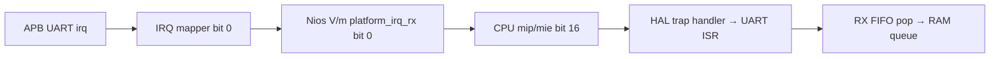

> **Ba chế độ demo:** `run_shell_demo.sh`, `run_irq_demo.sh`, `run_scope_demo.sh`. Xem [hướng dẫn đo sóng TX và chọn demo](HUONG_DAN_OSCILLOSCOPE_TX_DEMO.md).

> **Bổ sung:** shell đã có lệnh đổi baud/data/parity/stop lúc chạy từ Terminal 1 và Terminal 2. Xem [hướng dẫn runtime config](HUONG_DAN_DOI_CONFIG_RUNTIME.md). Demo đồng hồ là firmware riêng.

# Nios V/m, APB UART IRQ và demo đồng hồ

Cập nhật ngày 17/10/2026: **đã cài license IP-NIOSVM, build được `shell.sof` và
`demo.sof`, nạp thành công vào DE2-115 và kiểm tra UART/IRQ trên kit**.
Xem [báo cáo chạy kit](BAO_CAO_NAP_LICENSE_VA_CHAY_KIT_2026-10-17.md) cho kết quả,
log và giới hạn kiểm chứng. Các đoạn mô tả thiếu license bên dưới là lịch sử
lần kiểm tra đầu, trước khi người dùng cung cấp license.

## 1. Những gì vừa pull và những gì đã làm

Git ban đầu chỉ báo `wavedrom_rx.json` bị sửa; RTL mới đã commit trong:

- `56fe567`: thay coding style `uart_regs`, sửa khai báo testbench và `tx_uart`.
- `b471d81`: chuyển `baud_tick` RX/TX thành combinational.

Đã đọc báo cáo framing `BAO_CAO_FIX_FRAMING_VA_CHAY_TESTBENCH.md`. Không sửa thêm
RTL UART trong lượt này. `make test_all` chạy lại trên RTL hiện tại: APB UART
149/149, RX 7/7, full-duplex 3/3, firmware scenario 9/9; scoreboard TX=122,
RX=153, errors=0. Firmware scenario là BFM thao tác bus, không phải chạy C trên CPU.

Project mới có nguồn trong **`fpga/NIOS.qpf`**. Mở file đó bằng Quartus trên Linux
(`quartus`), không sửa chương trình `quartus.exe`. Project V/c cũ ở
`~/altera_lite/24.1std/NIOS.qpf` được giữ để đối chiếu; nó không phải project IRQ mới.
Các script ở repo hiện dùng `fpga/` và `build/images/`, không nạp `.sof` cũ ngoài repo.

| File | Vai trò |
|---|---|
| `fpga/system.qsys` | Nios V/m, APB UART IRQ0, timer CPU và PIO HEX3–HEX2 |
| `fpga/NIOS.v`, `NIOS.qsf`, `NIOS.sdc` | Top, chân, mức I/O, clock 50 MHz và ngoại lệ tín hiệu bất đồng bộ |
| `apb_uart_hw.tcl` | Trỏ trực tiếp `rtl/`, khai báo IRQ gắn với APB slave |
| `software/uart_irq.c` | ISR RX, hàng đợi RX/TX, bật/tắt TX IRQ đúng theo TX idle |
| `main.c` | Shell cũ dùng driver IRQ cho APB UART; thêm lệnh `irq` |
| `software/irq_demo.c`, `demo_clock.h` | Demo độc lập; timer interrupt và WFI |
| `scripts/build_soc.sh` | Generate → BSP mới → hai firmware → full compile → hai image |
| `scripts/check_soc.py`, `report_irq_path.tcl` | Kiểm tra map/chân/nguồn và đường IRQ sau fitting |
| `run_irq_demo.sh`, `scripts/check_irq_echo.py` | Nạp demo và kiểm tra echo khi có kit |

## 2. Có thể dùng V/c hay V/g để khỏi cần license V/m không?

Đã dùng `qsys-script` hỏi trực tiếp cả ba IP trong bản cài đặt, không chỉ dựa vào
mô tả trên mạng. Có thể chạy lại:

```bash
source scripts/toolchain_env.sh
qsys-script --script=scripts/probe_cpu.tcl
```

| CPU trong Quartus đang cài | Kết quả |
|---|---|
| Nios V/c 3.0.0 | Chỉ `clk`, `reset`, `data_manager`, `instruction_manager`; không có cổng IRQ ngoài, không có tham số bật CSR |
| Nios V/m 26.0.0 | Có `platform_irq_rx`, `timer_sw_agent`; cần license IP miễn phí |
| Nios V/g | Có IRQ nhưng cũng cần license IP riêng; đổi sang g không giải quyết việc thiếu license và thêm tính năng không cần thiết |

Trong `intel_niosv_c_unit_hw.tcl`, `platform_irq_rx` có khai báo dùng chung nội bộ,
nhưng `ENABLED false`, `irq_plat_vec TERMINATION 1`, `TERMINATION_VALUE 0`;
`CSR_ENABLED` mặc định 0 và không được IP V/c ngoài cung cấp tham số bật.
Vì vậy thấy chữ `irq` trong file không có nghĩa V/c của hệ thống này nhận được IRQ.
Không sửa file vendor để ép bật tính năng không được hỗ trợ.

Cần phân biệt tài liệu V/c Pro mới với V/c Standard cho Cyclone IV:
[AN 980 — khác biệt tính năng Standard/Pro](https://docs.altera.com/r/docs/778829/current/an-980-nios-v-processor-quartus-prime-software-support/features-support-and-microarchitecture?contentId=hbe3roNb6v1IgHayire7Zw).

V/m đã chọn là thay đổi nhỏ nhất đáp ứng IRQ trong bộ Nios V hiện có. Nios II/e
hoặc CPU RISC-V mã nguồn mở là hướng thiết kế khác, cần đổi toolchain/BSP và kiểm
chứng tích hợp lại; chưa triển khai vì không còn là chuyển đổi nhỏ của hệ thống này.

## 3. Kiến trúc và đường ngắt thật

Giữ CPU instruction/data AXI4-Lite, Merlin interconnect và APB translator/agent;
không đưa `avalon2apb.v` riêng vào thay thế đường bus Platform Designer hiện có.
Giữ 64 KB RAM, FIFO TX 16×8/RX 16×9, CFG/STT/IER và UART 9600 8N1.

| Ngoại vi | Base | Thay đổi |
|---|---|---|
| RAM | `0x00000000` | Không đổi, 64 KB, reset CPU tại 0 |
| PIO LED/HEX1–HEX0 | `0x00010000` | Không đổi |
| JTAG UART | `0x00010010` | Không đổi; console tùy chọn |
| PIO SW | `0x00010020` | Không đổi |
| PIO KEY | `0x00010030` | Không đổi |
| PIO HEX3–HEX2 | `0x00010040` | Thêm để đồng hồ độc lập với hiển thị ASCII |
| APB UART | `0x00020000` | Không đổi |
| Timer/software interrupt tích hợp CPU | `0x00030000` | Thêm kết nối vào data manager, phục vụ timer interrupt |



BSP sinh lại xác nhận `APB_UART_0_IRQ=0`, controller ID=0 và CSR support=1.
HAL tự ánh xạ Qsys IRQ0 sang bit16 CPU; chương trình truyền **0**, không truyền 16,
cho `alt_ic_isr_register`.

Sau fitting, TimeQuest tìm thấy 4 đường UART → CPU IRQ, ví dụ:

```text
apb_uart_0|u_rx_fifo|wptr[0]
  → intel_niosv_m_0|hart|csr_inst|irq_inst|A0_plat_irq_vec[0]
Setup slack: +15.528 ns
```

Đây là bằng chứng đường ngắt tồn tại trong netlist đã fitting, không phải chỉ là
dây trong XML. Xem `build/logs/fitted-irq-path.rpt` và bản chụp kết quả được lưu tại
`doc/verification/NIOSV_IRQ_2026-10-17.txt`.

## 4. Firmware hoạt động thế nào?

APB RX_DATA chỉ được đọc/pop trong ISR; vòng lặp ứng dụng lấy byte từ RAM queue.
ISR đọc STT để xác định nguồn ngắt và vét RX FIFO; đây là phục vụ ngắt, không phải
vòng lặp polling UART trong main. Mỗi queue có 255 vị trí sử dụng được; overflow,
framing/parity error và hardware overrun có bộ đếm riêng.

TX IRQ của RTL là **FIFO trống và shifter idle**, không phải “FIFO còn chỗ”.
Driver nạp burst tối đa 16 byte, đợi IRQ idle rồi nạp tiếp. Khi hết việc, tắt
TX_IE để không mắc bão ngắt ở trạng thái idle. IER bình thường=1; khi TX hoạt
động=3. Không bật riêng overrun IRQ; vẫn thống kê overrun trong RX ISR.

Shell giữ console JTAG truy cập không chặn để tương thích CLI cũ; JTAG RX vẫn là
polling riêng của console, không phải APB UART. `peek` chỉ cho CFG/STT/IER;
`poke 00` gửi qua TX queue, tránh shell phá trạng thái IER hoặc lấy mất byte RX.
`irq` in số lần ISR, RX bytes, dropped, errors, overruns.

Demo độc lập không polling RX/TX MMIO trong main. CPU đợi bằng WFI; timer 10 ms
điều khiển đồng hồ, không dùng busy-delay. JTAG log chỉ ghi khi có chỗ và có thể
bị bỏ nếu chưa mở terminal; không cần JTAG terminal để đồng hồ/echo tiếp tục chạy.

Demo đếm thập phân **00 → 01 → ... → 60 → 00**, đơn vị trên HEX2, chục trên HEX3.
Khi ISR nhận byte từ Terminal 2:

1. Giữ nguyên giây và phần giây đang đếm.
2. Echo đúng byte qua UART; HEX1–HEX0/LEDG hiển thị mã ASCII dạng hex.
3. Giữ khoảng 1 giây kể từ byte cuối để nhìn rõ việc dừng, và không đếm khi còn
   RX/TX đang chờ xử lý.
4. Tiếp tục phần giây đang dở, không reset về 00.

Kiểm thử thuật toán thực tế dùng trong demo: dừng tại 37,45 giây, nhận/echo,
tiếp tục 0,55 giây thì lên 38; kiểm tra cả 60 → 00. Đây là đồng hồ demo theo tick
10 ms danh định, không phải phép đo hiệu chuẩn thời gian.

## 5. Kết quả build và timing

- Generate HDL, tạo BSP từ `.sopcinfo` mới: PASS.
- C shell và demo: build ELF/HEX PASS, ISA `rv32i_zicsr`, không phát lệnh M/A/F
  ngoài khả năng CPU. GCC 15 cần ghi rõ `_zicsr` để assembler chấp nhận CSR.
- Bật enhanced HAL interrupt API; HAL JTAG dùng small driver để không tranh cổng
  với console truy cập trực tiếp. Không tự sửa mã nguồn HAL/vendor.
- Shell khoảng 20,57 KB chương trình; demo khoảng 12,89 KB; còn hơn 42/50 KB cho
  stack và heap. Còn cảnh báo kiểu trả về trong header HAL vendor.
- Fitting Cyclone IV EP4CE115F29C7: PASS, 4.139 LE, 2.258 registers,
  527.632 memory bits, 49 pins, không PLL, không DSP multiplier.
- Worst setup CLOCK_50 +5,410 ns; worst hold qua các corner +0,148 ns;
  slow 85°C fmax 68,54 MHz, đáp ứng clock 50 MHz.
- STA còn ba port JTAG reserved chưa có delay ngoài: TDI, TMS, TDO. Không gọi đây
  là kiểm chứng timing ngoài của USB-Blaster. Các I/O bất đồng bộ/human-visible
  được except rõ trong SDC; đường synchronous nội bộ vẫn được phân tích.
- Cảnh báo I/O assignment còn lại là drive strength/slew rate dùng giá trị mặc
  định, không phải thiếu vị trí pin hay mức I/O. Chưa thay đổi các giá trị điện
  này so với project cũ khi chưa đo trên board.
- Cảnh báo truncation bộ chia baud: các giá trị ở 50 MHz đều vừa 15 bit; chưa đổi
  RTL chỉ để dọn cảnh báo. Cảnh báo chân vào 3,3 V yêu cầu thiết bị ngoài đúng mức
  điện áp; không dùng đầu RS-232 hoặc TTL 5 V nối thẳng GPIO.

**Lịch sử trước khi cài license: Quartus báo Full Compilation successful nhưng không tạo programming file.**
Warnings 115003/115005 nêu IP chưa có license; 24850 báo token expired HTTP 401.
Không được lấy mã exit 0 hay dòng “successful” làm bằng chứng đã có `.sof`.
Script build kiểm tra file `.sof` mới thực sự tồn tại và dừng nếu không có.
Không dùng `asm_bypass_opencore_log` để che hoặc bỏ qua lỗi license.

## 6. License: không cần mua V/m

[Nios V Design Handbook](https://cdrdv2-public.intel.com/820962/ug-726952-820962.pdf)
xác nhận license các lõi Nios V được cấp miễn phí.
[Tài liệu lỗi token](https://cdrdv2-public.intel.com/821877/quartus_install-683472-821877.pdf)
giải thích token hết hạn có thể cần lấy license thủ công hoặc cập nhật Quartus.

Các hướng đã kiểm tra: auto-fetch khi compile (HTTP 401), các cổng/tham số V/c,
IRQ V/g, và lệnh Tcl licensing của Quartus đang cài. CLI chỉ công bố
`get_project_license_status`, `get_license_xml`, không có lệnh refresh token.
Không thay đổi ngày máy, file encrypted hoặc cơ chế kiểm tra license.

Cách ít thay đổi hệ thống nhất:

1. Đăng nhập [Self-Service Licensing Center](https://licensing.intel.com/psg/s/).
2. Chọn **Sign up for Evaluation or Free Licenses** → **IP-NIOSVM**. Đây là
   license IP miễn phí, không phải mua Quartus Standard/Pro.
3. Gắn license với máy theo hướng dẫn SSLC, tải file `.dat`.
4. Quartus → Tools → License Setup → chọn file, hoặc chạy shell với:
   `export LM_LICENSE_FILE=/duong/dan/license.dat`.
5. Chạy lại `./scripts/build_soc.sh`.

License hiện đã được người dùng cấp và lưu ở `~/.altera/license.dat`; script tự
nhận đường dẫn này và giữ các license khác trong `LM_LICENSE_FILE`. Bước cấp
license mới vẫn cần tài khoản của người dùng; agent không có phiên SSLC để tự
phát hành license. Có thể kiểm tra tùy chọn Automatically Refresh License Server
Token trên bản GUI hỗ trợ; bản 24.1 hiện đã thử auto-fetch và vẫn bị từ chối.
Đổi sang V/g không bỏ được bước license. V/c Pro đời mới có tính năng khác nhưng
không phải phương án thay thế trực tiếp trên Cyclone IV với Quartus đang cài.

## 7. Build lại hoàn toàn, rồi nạp

Từ thư mục repo:

```bash
# Không cần kit: hồi quy và kiểm tra C/driver
make test_all
make test_irq_driver test_demo_clock

# Sau khi license IP-NIOSVM đã cài: rebuild từ RTL hiện tại
./scripts/build_soc.sh
```

Script đặt đúng `QUARTUS_ROOTDIR`, `SOPC_KIT_NIOS2`, GCC và Java headless.
Đổi `ALTERA_DIR`/`RISCV_BIN` nếu đổi bản cài đặt. Log trong `build/logs/`.
Khi có license, đầu ra mong đợi: `build/images/shell.sof`, `demo.sof` và hai `.elf`.
Hai image cùng phần cứng, khác nội dung RAM lúc boot. Không cần `niosv-download`;
CPU khởi động bằng RAM initialization như hệ thống cũ. Debug module vẫn tắt.

```bash
# Nạp và mở shell (cần kit)
./flash_fpga.sh
./run_terminal_jtag.sh

# Hoặc nạp demo riêng và mở JTAG log
./run_irq_demo.sh

# Build đầy đủ, nạp shell và mở terminal trong một lệnh
./build_and_run.sh
```

Script flash so fingerprint nguồn để từ chối nạp image cũ sau khi sửa RTL/C.
Không tự reset/kill `jtagd`; khi thiếu USB-Blaster sẽ báo lỗi rõ ràng.
Nếu có nhiều cáp, đặt `CABLE` đúng tên từ `jtagconfig`.

## 8. Đấu dây và demo khi có kit

Theo [manual DE2-115](https://www.terasic.com.tw/attachment/archive/502/DE2_115_User_manual.pdf)
và bảng chân local `~/Downloads/DE2-115 Pin Assignments.csv`:

| Phía FPGA | Chân FPGA | Phía USB–UART |
|---|---|---|
| UART_RXD = GPIO[0] | AB22 | TX của adapter |
| UART_TXD = GPIO[1] | AC15 | RX của adapter |
| GND | GND trên header | GND adapter |

Đây là GPIO trên header 40 chân, không phải cổng DB9 RS-232. Dùng logic 3,3 V,
không cấp 5 V vào tín hiệu GPIO. Board dùng nguồn riêng; nối chung GND.
Nếu dùng ESP32 làm adapter, cần bảo đảm MCU ESP32 không đồng thời lái đường TX.

Mức nguồn bank phải phù hợp jumper: GPIO/bank4 3,3 V (JP6), bank5 HEX2 và một
phần HEX3 2,5 V (JP7). HEX3[0:1]=2,5 V; HEX3[2:6]=3,3-V LVTTL.
Không đặt toàn bộ HEX3 thành 2,5 V. Vị trí jumper thực tế phải đối chiếu manual
board trước khi bật nguồn; chưa đo điện áp trên kit trong lượt này.

HEX2[0..6]: AA25, AA26, Y25, W26, Y26, W27, W28.
HEX3[0..6]: V21, U21, AB20, AA21, AD24, AF23, Y19.
CLOCK_50=Y2; reset KEY0=M23, tích cực thấp. UART không đi qua chân IRQ ngoài kit:
IRQ là dây nội bộ FPGA từ UART tới CPU.

Terminal 1 dùng USB-Blaster/JTAG. Terminal 2 dùng USB–UART riêng:

```bash
./run_terminal_pc.sh /dev/ttyUSB0
# 9600 baud, 8 data, no parity, 1 stop, không flow control
```

Dùng `/dev/serial/by-id/...` nếu có nhiều adapter; tắt local echo để không nhầm
ký tự PC tự hiển thị với byte echo từ FPGA. Đừng mở hai chương trình cùng cổng.

Quan sát đồng hồ lên ví dụ 17, gõ `A` từ Terminal 2: nhận lại `A`, HEX1–HEX0=41,
HEX3–HEX2 giữ 17 khoảng 1 giây rồi tiếp tục 18, không về 00. JTAG có dòng RX/ISR.
Gõ liên tiếp `xyz` phải nhận `xyz`, không đảo/mất byte. Gõ Enter cũng tạo byte
CR/LF nên sẽ làm đồng hồ dừng lại theo cơ chế tương tự.

Có thể thay Terminal 2 bằng script kiểm tra tự động (cần Python có pyserial):

```bash
python3 scripts/check_irq_echo.py /dev/ttyUSB0
```

Script gửi 1 byte, chuỗi ngắn và burst 95 byte, so chính xác byte echo. Đồng thời
quan sát đồng hồ và ISR counter; chỉ kiểm tra echo không đủ chứng minh dùng IRQ.
Trong shell dùng lệnh `irq` để xem dropped/error/overrun; demo log in ISR count.

Đã hoàn tất build/nạp và kiểm tra trên kit sau khi có license; xem báo cáo chạy
kit mới để phân biệt kết quả thực đo với kiểm thử host trước đó. Chưa đo baud và
điện áp bằng oscilloscope, chưa đo coverage hoặc chạy mọi tình huống reset giữa
khung. Kết quả PASS chỉ áp dụng các kịch bản đã chạy.

Kiểm tra tự động đầy đủ với log JTAG và quay vòng đồng hồ:

```bash
python3 scripts/check_irq_hardware.py /dev/ttyUSB0 --wrap-check
```

Đóng các terminal JTAG/serial khác trước khi chạy; test không nạp hoặc reset FPGA.
Có thể bỏ `--wrap-check` để chỉ kiểm tra echo, ISR và pause/resume. ESP32 trong
lần chạy kit này được người dùng xác nhận EN nối GND.
