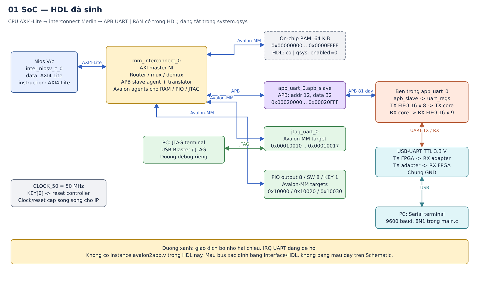
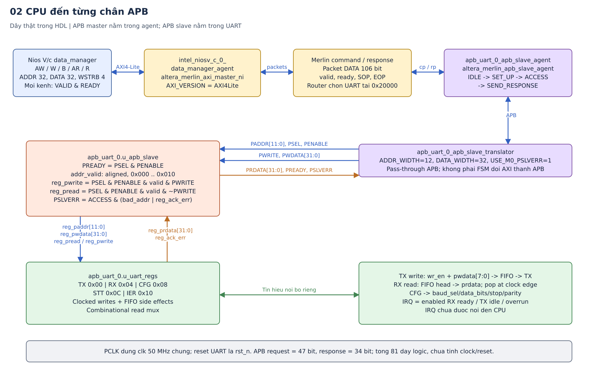
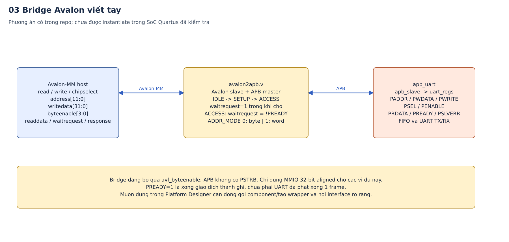

# CPU giao tiếp với APB UART như thế nào trong chính dự án này?

Kiểm tra ngày 16/10/2026. Đọc RTL trong repo, project Quartus thật, HDL do Platform Designer sinh, BSP, chương trình C, XML bạn gửi và đặc tả APB có trong `doc/`.

**Kết luận quan trọng nhất: trong HDL hệ thống đã sinh, Nios V/c đang phát AXI4-Lite. Platform Designer chuyển giao dịch qua interconnect Merlin thành APB để truy cập UART. `avalon2apb.v` là một bridge Avalon-MM → APB riêng trong repo, chưa được instantiate trong hệ thống Quartus đó.** Vì vậy, cần hiểu cả hai đường nhưng phải phân biệt chúng khi vẽ schematic.

## 1. Xem hình trước, rồi lần theo từng lớp



Có thể mở và sửa ba trang trong [CPU_APB_UART.drawio](cpu_apb/CPU_APB_UART.drawio):

1. SoC và các nhánh RAM, UART, JTAG, PIO.
2. Đường CPU → interconnect → từng chân APB → register file.
3. Đường dùng bridge Avalon viết tay, để đối chiếu.

[Ảnh Schematic chụp trực tiếp trong Platform Designer](cpu_apb/platform_designer_schematic.png) cho thấy cấu hình hiện mở: không có RAM trên sơ đồ; `instruction_manager` không nối tới RAM đang bật; cảnh báo UART và JTAG UART chưa nối interrupt receiver. Hình vector ở trên mô tả **HDL đã sinh**, đồng thời đánh dấu RAM hiện disabled trong Qsys để tránh trộn hai trạng thái.

Tư duy nên giữ khi đọc hình: CPU ra lệnh đọc/ghi một địa chỉ; interconnect tìm ngoại vi tương ứng và chuyển giao thức; ngoại vi cập nhật thanh ghi/FIFO; UART mới chuyển byte thành tín hiệu nối tiếp. Mỗi tầng có cách bắt tay riêng.

## 2. Đã kiểm tra project nào, và bằng chứng nằm ở đâu?

Repo đang mở là `/home/vietanh/Downloads/code/UART/UART`. Project Quartus thực tế được các script trong repo tham chiếu nằm tại `/home/vietanh/altera_lite/24.1std`.

| Căn cứ | Nội dung xác nhận |
|---|---|
| [`NIOS.qsf`](/home/vietanh/altera_lite/24.1std/NIOS.qsf) | Cyclone IV E, EP4CE115F29C7; top `NIOS`; dùng `system.qsys`; gán chân FPGA |
| [`NIOS.v`](/home/vietanh/altera_lite/24.1std/NIOS.v) | Top nối `CLOCK_50`, reset, PIO, UART RX/TX vào instance `system u0` |
| [`system.qsys`](/home/vietanh/altera_lite/24.1std/system.qsys) | IP, kết nối, base address, `enableAvalonInterface=false`, RAM `enabled=0` |
| [`system.v`](/home/vietanh/altera_lite/24.1std/system/synthesis/system.v) | Dây AXI của CPU; tám nhóm tín hiệu APB vào UART; `.irq()` để hở; vẫn instantiate RAM |
| [`system_mm_interconnect_0.v`](/home/vietanh/altera_lite/24.1std/system/synthesis/submodules/system_mm_interconnect_0.v) | `altera_merlin_axi_master_ni`, `AXI_VERSION="AXI4Lite"`; APB agent và translator |
| [`system.h`](/home/vietanh/altera_lite/24.1std/software/bsp/system.h) | UART base `0x20000`, span 4096; RAM span 65536; UART IRQ `-1` |
| [`apb_uart_hw.tcl`](../apb_uart_hw.tcl) | Interface UART khai báo `apb end`; clock/reset/conduit/interrupt tách riêng |
| [`apb_uart.v`](../rtl/apb_uart.v), [`apb_slave.v`](../rtl/apb_slave.v), [`uart_regs.v`](../rtl/uart_regs.v) | Kết nối và hành vi của ngoại vi trong repo |
| [`avalon2apb.v`](../avalon2apb.v) | Bridge viết tay, có Avalon slave và APB master |
| [`main.c`](../main.c) | MMIO 32-bit; TX/RX FIFO; polling; terminal JTAG và serial riêng |

Đã mở Quartus bản Linux và Platform Designer của project thật; executable trên máy là `quartus`, không phải `quartus.exe` của Windows. Đã đọc trực tiếp tab **Schematic**. Chưa mở RTL Viewer để khảo sát netlist sau tổng hợp; phần chi tiết interconnect trong tài liệu này được lần theo từ HDL đã sinh. Không regenerate hệ thống, compile lại FPGA hay nạp kit trong lần kiểm tra này.

Cấu hình Qsys và HDL hiện không đồng bộ hoàn toàn: RAM có `memorySize=65536` nhưng `enabled=0` trong Qsys; HDL, SOPCINFO và BSP vẫn mô tả RAM 64 KiB. Báo cáo build thành công có sẵn không chứng minh cấu hình Qsys đang lưu có thể chạy nếu generate lại. Bản vẽ gốc ghi RAM 128 KB không khớp cả hai nguồn trên. Không thể suy ra bitstream nào đang nằm trên kit chỉ từ các file này.

## 3. Một đường trên Schematic thật ra đại diện cho cái gì?

Trong Platform Designer, đường nối `data_manager` đến `apb_slave` là **kết nối interface**. Nó biểu diễn cả một giao diện đọc/ghi, không có nghĩa CPU nối đúng một sợi dây đến UART.

Có ba cấp tên rất dễ nhầm:

- `apb_uart_0`: một **instance IP** trong hệ thống.
- `apb_uart_0.apb_slave`: tên **interface APB** do TCL khai báo.
- `apb_uart_0.u_apb_slave`: **module Verilog con** bên trong IP, xử lý tín hiệu APB.

Interface là bản mô tả một bó tín hiệu và quy tắc của chúng. Module là mạch thực hiện chức năng. Tên interface giống tên module không làm chúng trở thành cùng một đối tượng.

Trong Qsys có dòng kết nối `kind="avalon"` từ `intel_niosv_c_0.data_manager` sang `apb_uart_0.apb_slave`. **Không dùng riêng chữ `kind="avalon"` để kết luận các chân CPU là Avalon-MM.** Hai bằng chứng trực tiếp hơn là tham số CPU và HDL: `enableAvalonInterface=false`, các chân `awaddr/wvalid/arvalid/rdata/...`, cùng `AXI_VERSION="AXI4Lite"` ở network interface.

Nios V/c cho phép chọn Avalon-MM hoặc AXI. Việc tắt “Enable Avalon Interface” dùng AXI4-Lite, phù hợp cấu hình vừa đọc. Xem [tham số CPU chính thức của Altera](https://docs.altera.com/r/docs/726952/25.3.1/nios-v-embedded-processor-design-handbook/cpu-architecture-tab).

## 4. Đường đang có trong HDL: CPU → AXI4-Lite → Merlin → APB



Có thể đọc hierarchy theo thứ tự sau:

```text
NIOS
└── u0 : system
    ├── intel_niosv_c_0
    │   ├── data_manager          [AXI4-Lite: MMIO và dữ liệu]
    │   └── instruction_manager   [AXI4-Lite: lấy lệnh từ RAM]
    ├── mm_interconnect_0
    │   ├── intel_niosv_c_0_data_manager_agent
    │   │   └── loại: altera_merlin_axi_master_ni
    │   ├── router / command mux-demux / response mux-demux
    │   ├── apb_uart_0_apb_slave_agent
    │   │   └── loại: altera_merlin_apb_slave_agent
    │   └── apb_uart_0_apb_slave_translator
    │       └── loại: altera_merlin_apb_translator
    └── apb_uart_0
        ├── u_apb_slave
        ├── u_uart_regs
        ├── u_tx_fifo → u_tx_uart
        └── u_rx_uart → u_rx_fifo
```

`instruction_manager` và `data_manager` thuộc cùng một CPU. Trong hệ thống HDL đã sinh, cả hai có đường tới RAM, nhưng nhánh UART chỉ nối từ `data_manager`. Việc lấy lệnh từ RAM và việc truy cập UART là hai loại truy cập khác nhau.

**Bước 1 — phía CPU dùng AXI4-Lite.** Có năm kênh độc lập:

| Kênh | CPU → interconnect | Interconnect → CPU | Ý nghĩa |
|---|---|---|---|
| AW | `awaddr[31:0]`, `awprot[2:0]`, `awvalid` | `awready` | Địa chỉ ghi |
| W | `wdata[31:0]`, `wstrb[3:0]`, `wvalid` | `wready` | Dữ liệu ghi và byte lane |
| B | `bready` | `bresp[1:0]`, `bvalid` | Phản hồi ghi |
| AR | `araddr[31:0]`, `arprot[2:0]`, `arvalid` | `arready` | Địa chỉ đọc |
| R | `rready` | `rdata[31:0]`, `rresp[1:0]`, `rvalid` | Dữ liệu/phản hồi đọc |

Tên đầy đủ trong `system.v` có tiền tố `intel_niosv_c_0_data_manager_`. Một kênh truyền thành công tại cạnh clock khi **VALID và READY của chính kênh đó cùng bằng 1**. AW và W có bắt tay riêng; nhận địa chỉ/dữ liệu ghi chưa đồng nghĩa toàn bộ giao dịch ghi đã nhận phản hồi B.

**Bước 2 — AXI network interface tạo packet nội bộ.** `intel_niosv_c_0_data_manager_agent` chuyển lệnh thành command packet. Tại nhánh APB được kiểm tra, `cp_data/rp_data` rộng **106 bit**, đi cùng `valid`, `ready`, `startofpacket`, `endofpacket`; phía command có `channel[5:0]`. Packet chứa địa chỉ, dữ liệu, loại đọc/ghi, byte enable và thông tin định tuyến. Đây là định dạng nội bộ Merlin dùng các interface streaming; **106 bit không phải độ rộng dữ liệu thanh ghi UART**, cũng không phải bus Avalon-MM 106 bit.

**Bước 3 — router chọn đích theo địa chỉ.** Vùng `0x20000..0x20FFF` đi tới UART; RAM, PIO và JTAG UART có các nhánh riêng. Không phải mọi lệnh CPU đều chạy qua APB UART. Cạnh tranh truy cập RAM giữa hai manager được interconnect xử lý.

**Bước 4 — APB agent phát chu kỳ APB.** Module tên `altera_merlin_apb_slave_agent` phục vụ một APB slave trong mạng. Tuy có chữ “slave” trong tên, các chân APB của nó có vai trò **master/requester**: phát `PADDR`, `PSEL`, `PENABLE`, `PWRITE`, `PWDATA`; nhận `PRDATA`, `PREADY`, `PSLVERR`.

FSM của agent là `IDLE → SET_UP → ACCESS → SEND_RESPONSE`. Agent giữ phản hồi khi mạng chưa nhận; không giữ APB ACCESS để phát lại thao tác pop FIFO. Cơ chế này đặc biệt quan trọng với thanh ghi RX có tác dụng phụ khi đọc.

**Bước 5 — APB translator đưa tín hiệu ra UART.** Translator đang có `ADDR_WIDTH=12`, `DATA_WIDTH=32`, `USE_M0_PSLVERR=1`. Nó chủ yếu nối qua các tín hiệu APB và xử lý tùy chọn cổng. FSM tạo SETUP/ACCESS nằm ở **agent**, không nằm ở translator.

**Bước 6 — phản hồi đi ngược về CPU.** UART → translator → APB agent → response packet → AXI network interface → `RDATA/RRESP/RVALID` hoặc `BRESP/BVALID`. `PSLVERR` được giữ lại trong packet response; trong cấu hình này OKAY là `00`, SLVERR là `10`. Có phản hồi lỗi trên dây không tự chứng minh chương trình C xử lý lỗi bằng ISR hay exception theo cách cụ thể; điều đó cần kiểm tra thêm cơ chế CPU/phần mềm.

Cách tổ chức agent/router/translator phù hợp mô tả của Intel về [interconnect và APB agent](https://cdrdv2-public.intel.com/704994/ug-qpp-platform-designer-18-1-683609-704994.pdf). Platform Designer hỗ trợ ghép các giao thức memory-mapped khác nhau; xem [tài liệu Standard Edition](https://docs.altera.com/r/docs/683364/18.1/intel-quartus-prime-standard-edition-user-guide-platform-designer/memory-mapped-interfaces).

## 5. Chính xác APB nối bằng những chân nào?

`M` dưới đây là APB agent trong interconnect; `S` là `apb_uart_0`. Các tên cổng trong RTL viết chữ thường; ký hiệu chuẩn APB thường viết chữ hoa.

| Chân UART | Rộng | Hướng | Tác dụng |
|---|---:|---|---|
| `paddr[11:0]` | 12 | M → S | Offset byte của thanh ghi trong vùng UART |
| `psel` | 1 | M → S | Chọn ngoại vi UART cho giao dịch hiện tại |
| `penable` | 1 | M → S | Phân biệt pha ACCESS với pha SETUP |
| `pwrite` | 1 | M → S | 1 = ghi; 0 = đọc |
| `pwdata[31:0]` | 32 | M → S | Dữ liệu cần ghi |
| `prdata[31:0]` | 32 | S → M | Dữ liệu đọc về |
| `pready` | 1 | S → M | Slave có thể kết thúc ACCESS |
| `pslverr` | 1 | S → M | Giao dịch hoàn tất nhưng có lỗi |
| `clk` | 1 | clock chung → các IP | Tương ứng PCLK, đang là 50 MHz |
| `rst_n` | 1 | reset controller → UART | Reset tích cực thấp, tương ứng PRESETn |

Tổng tám nhóm tín hiệu giao dịch là **81 dây logic**: 47 dây master → slave và 34 dây slave → master, chưa tính clock/reset. Chúng nằm trong FPGA; không phải cần 81 chân cắm trên board.

Một kết nối thật trong HDL:

```verilog
.paddr   (mm_interconnect_0_apb_uart_0_apb_slave_paddr),
.psel    (mm_interconnect_0_apb_uart_0_apb_slave_psel),
.penable (mm_interconnect_0_apb_uart_0_apb_slave_penable),
.pwrite  (mm_interconnect_0_apb_uart_0_apb_slave_pwrite),
.pwdata  (mm_interconnect_0_apb_uart_0_apb_slave_pwdata),
.prdata  (mm_interconnect_0_apb_uart_0_apb_slave_prdata),
.pready  (mm_interconnect_0_apb_uart_0_apb_slave_pready),
.pslverr (mm_interconnect_0_apb_uart_0_apb_slave_pslverr)
```

Đây là tập tín hiệu tương ứng APB3; thiết kế không có `PSTRB` để chọn byte lane, không có `PPROT`. Đặc tả APB mới hơn có các tín hiệu tùy chọn đó nhưng không thể coi chúng tự tồn tại trong mạch này.

## 6. Base address, offset và register file

CPU thấy địa chỉ toàn cục 32 bit. UART chỉ cần biết thanh ghi nào trong vùng 4 KiB của nó. Với base `0x20000` và vùng căn 4 KiB này:

```text
CPU truy cập CFG: 0x00020008
Router chọn UART: thuộc [0x00020000, 0x00021000)
PADDR đến UART:   0x008
```

Ở đây lấy 12 bit thấp cho kết quả tương đương trừ base. Không suy rộng thành việc mọi hệ thống đều chỉ cần cắt bit; cấu hình ánh xạ và adapter mới quyết định phép dịch địa chỉ.

| Địa chỉ CPU | PADDR | Thanh ghi | Hành vi RTL hiện tại |
|---|---|---|---|
| `0x00020000` | `0x000` | TX | Ghi byte thấp vào TX FIFO; đọc trả 0 |
| `0x00020004` | `0x004` | RX | Đọc đầu RX FIFO; pop một phần tử nếu có; ghi báo lỗi |
| `0x00020008` | `0x008` | CFG | Đọc/ghi 7 bit cấu hình; chỉ cho ghi khi UART idle |
| `0x0002000C` | `0x00C` | STT | Đọc trạng thái; ghi báo lỗi |
| `0x00020010` | `0x010` | IER | Đọc/ghi 3 bit cho phép nguồn ngắt |

Span 4096 byte nghĩa interconnect cấp cửa sổ địa chỉ 4 KiB. Nó **không có nghĩa UART có RAM 4 KiB**, cũng không có nghĩa mọi offset trong cửa sổ đều hợp lệ. `apb_slave` chỉ nhận các offset căn 4 byte từ `0x000` đến `0x010`; offset `0x014` đã báo lỗi.

`CFG[1:0]` chọn 5/6/7/8 data bit; bit 2 chọn 1/2 stop; bit 3 bật parity; bit 4 chọn even/odd; `[6:5]` chọn 2400/4800/9600/19200. `main.c` ghi `0x43`, tức 9600-8N1. `0x4B` là 9600-8E1.

| Bit STT | Ý nghĩa |
|---:|---|
| 0 | `!tx_busy && tx_fifo_empty`: đã phát xong toàn bộ dữ liệu |
| 1 | RX FIFO có dữ liệu |
| 2 | Bit lỗi của phần tử đầu RX FIFO |
| 3 | Cờ overrun đã chốt |
| 4 | TX FIFO đầy |
| 5 | RX FIFO đầy |

Để biết có thể ghi thêm một byte TX, phần mềm xem **bit 4 bằng 0**. Bit 0 bằng 1 là điều kiện mạnh hơn: TX core rảnh và FIFO rỗng. Không cần chờ bit 0 trước từng byte nếu muốn tận dụng FIFO.

Dữ liệu RX trả trên `[7:0]`, bit 8 đi kèm lỗi. Trong `error_check.v` hiện đọc, logic lỗi kiểm tra parity; tên/comment “Frame/Parity” trong một số tài liệu không đủ để chứng minh đã có phát hiện framing error đầy đủ.

## 7. Từ APB vào bên trong UART: đây là tín hiệu nội bộ riêng

`apb_slave.v` hiện tại là **mạch tổ hợp**, không chứa FSM. FSM pha APB nằm ở phía master. Ở bản Quartus, module này có thêm cổng `pclk/preset_n`, nhưng phần xử lý bus vẫn là các phép gán tổ hợp; các cổng đó không tạo thêm một tầng FSM.

```verilog
pready = psel & penable;
addr_valid = (paddr <= 12'h010) && (paddr[1:0] == 2'b00);
reg_pread  = psel & penable & addr_valid & ~pwrite;
reg_pwrite = psel & penable & addr_valid &  pwrite;
pslverr = psel & penable & (!addr_valid | reg_ack_err);
```

| Tín hiệu giữa `apb_slave` và `uart_regs` | Hướng | Ý nghĩa |
|---|---|---|
| `reg_paddr[11:0]` | slave → regs | Offset thanh ghi |
| `reg_pwdata[31:0]` | slave → regs | Dữ liệu ghi |
| `reg_pwrite` | slave → regs | Enable ghi trong ACCESS hợp lệ địa chỉ |
| `reg_pread` | slave → regs | Enable đọc trong ACCESS hợp lệ địa chỉ |
| `reg_prdata[31:0]` | regs → slave | Kết quả mux đọc |
| `reg_ack_err` | regs → slave | Vi phạm quyền/điều kiện truy cập |

Đó là **giao diện register nội bộ riêng của thiết kế**, không phải một bus APB thứ hai: không còn cặp SETUP/ACCESS hay handshake độc lập.

Ở `uart_regs`, ghi TX chỉ hợp lệ nếu FIFO chưa đầy; ghi CFG chỉ hợp lệ nếu TX đã hết và RX không bận; IER luôn cho ghi. Ghi STT/RX báo lỗi. Điều kiện sai hoàn tất bằng `PSLVERR`, không kéo dài PREADY để chờ FIFO có chỗ.

TX FIFO nhận `tx_fifo_wr_en`, `tx_fifo_wr_data[7:0]`. `start_tx = !tx_fifo_empty`, TX core tự nạp byte khi rảnh; `load_reg` làm FIFO pop phần tử vừa nạp. RX core nhận serial, đưa `{error, rx_uart_data}` vào FIFO 16 × 9; đọc RX tạo `rx_fifo_rd_en` và pop tại cạnh clock. Không cần thanh ghi CTRL/start_tx do CPU ghi như tài liệu cũ.

Tại một lần đọc RX, dữ liệu đầu FIFO có sẵn trước cạnh hoàn tất nhờ `dout` tổ hợp. Master lấy dữ liệu cũ ở cạnh đó; FIFO cập nhật con trỏ sau cạnh. Vì thế testbench phải lấy mẫu đúng thời điểm, không đợi sau khi FIFO đã pop rồi mới coi `PRDATA` là byte vừa đọc.

## 8. Theo dõi một giao dịch từng chu kỳ

Trong APB, một giao dịch tối thiểu có một chu kỳ SETUP và một chu kỳ ACCESS. Kết thúc khi **PSEL && PENABLE && PREADY cùng bằng 1 tại cạnh lên PCLK**. `PADDR`, `PWRITE`, `PWDATA` phải giữ ổn định từ SETUP qua ACCESS. Nếu PREADY thấp, master kéo dài ACCESS và tiếp tục giữ thông tin đó. Xem đặc tả ARM có sẵn trong repo: [IHI0024D, chương 3](IHI0024D_amba_apb_protocol_spec.pdf).

Ví dụ ghi `'A' = 0x41` vào TX, FIFO còn chỗ:

| Khoảng thời gian | IDLE | E0 → E1: SETUP | E1 → E2: ACCESS | Sau E2 |
|---|---:|---:|---:|---:|
| PSEL | 0 | 1 | 1 | 0 |
| PENABLE | 0 | 0 | 1 | 0 |
| PWRITE | — | 1 | 1 | — |
| PADDR | — | `0x000` | `0x000` | — |
| PWDATA | — | `0x41` | `0x41` | — |
| PREADY của slave này | 0 | 0 | 1 | 0 |
| reg_pwrite | 0 | 0 | 1 | 0 |
| Tác dụng | chưa có | đặt yêu cầu | chuẩn bị nhận | tại E2 đã push đúng một byte |

E0, E1, E2 là các cạnh lên liên tiếp; mỗi khoảng giữa chúng dài 20 ns ở 50 MHz. Phần APB tối thiểu dài 40 ns từ đầu SETUP đến cạnh hoàn tất. Độ trễ toàn bộ CPU → UART còn có interconnect và phản hồi AXI; không được đồng nhất với 40 ns này.

Các câu hỏi cần tách rõ:

- **PREADY=1:** thao tác thanh ghi có thể hoàn tất tại cạnh tới.
- **PSLVERR=0:** thao tác đó hợp lệ.
- **STT[0]=1:** toàn bộ hàng đợi TX và TX core đã hết việc.

CPU ghi TX xong chỉ có nghĩa byte được nhận vào FIFO, không có nghĩa chân TX đã phát xong. Một frame 8N1 ở 9600 baud có 10 bit, mất xấp xỉ **1,042 ms** trên dây; lớn hơn nhiều thời gian giao dịch APB.

### Ví dụ C gửi một ký tự

```c
/* UART đã được cấu hình 9600-8N1, ví dụ CFG = 0x43. */
while (IORD_32DIRECT(APB_UART_0_BASE, 0x0C) & (1u << 4)) {
    /* Đợi TX FIFO còn chỗ. */
}
IOWR_32DIRECT(APB_UART_0_BASE, 0x00, 0x41);
```

1. CPU đọc STT bằng một giao dịch MMIO riêng.
2. CPU thực hiện ghi 32-bit tới `0x20000`, dữ liệu `0x41`.
3. AXI request được network interface đóng packet và router đưa tới APB agent.
4. Agent phát SETUP rồi ACCESS với `PADDR=0`, `PWRITE=1`.
5. `uart_regs` kiểm tra FIFO, tạo `tx_fifo_wr_en`; FIFO nhận byte thấp tại cạnh hoàn tất.
6. Interconnect trả phản hồi ghi về CPU; TX core tự lấy byte và phát start/data/stop ra chân TX.

Không có CPU chạy phần mềm ở trong bridge. Bridge/interconnect là logic phần cứng hoạt động theo clock.

### Ví dụ CPU lấy một ký tự PC gửi đến

```text
PC -> USB-UART.TX -> FPGA.UART_RXD
   -> đồng bộ RX -> UART RX core -> RX FIFO
   -> CPU đọc STT thấy bit 1 = 1
   -> CPU đọc 0x20004
   -> APB đọc PADDR=0x004
   -> PRDATA mang phần tử đầu FIFO; FIFO pop tại cạnh hoàn tất
   -> RDATA quay về CPU -> chương trình C lấy [7:0]
```

CPU chưa đọc thì FIFO vẫn giữ byte. Nếu FIFO còn nhiều byte, đọc một lần không làm STT[1] về 0 ngay. Bit này chỉ hạ khi FIFO rỗng. Cờ overrun được xóa khi có lần pop RX hợp lệ.

## 9. Vậy `avalon2apb.v` của repo dùng thế nào?



Đây là phương án khác:

```text
Avalon-MM host -> Avalon slave [avalon2apb] APB master -> apb_uart
```

Phía Avalon, host phát `avl_read` hoặc `avl_write`, `avl_address`, `avl_writedata`, có thể kèm `avl_chipselect`. Bridge trả `avl_readdata`, `avl_waitrequest`, `avl_response`. Nó không phải Avalon-MM master; nó nhận yêu cầu từ host.

| Trạng thái bridge | APB | Avalon waitrequest |
|---|---|---|
| IDLE, chưa có yêu cầu | PSEL=0, PENABLE=0 | 0 |
| IDLE, vừa có yêu cầu | chờ cạnh để chốt địa chỉ/dữ liệu | 1 |
| SETUP | PSEL=1, PENABLE=0 | 1 |
| ACCESS, chưa sẵn sàng | PSEL=1, PENABLE=1 | 1 |
| ACCESS, PREADY=1 | hoàn tất ở cạnh clock | 0 |

Bridge chốt địa chỉ, dữ liệu và hướng truy cập khi bắt đầu; giữ qua ACCESS. Host phải giữ yêu cầu theo quy tắc Avalon cho đến cạnh clock `read/write && !waitrequest`. Trong chu kỳ hoàn tất, `avl_readdata` lấy trực tiếp `PRDATA`; `avl_response` đổi `PSLVERR` thành `00/10`. Bridge cũng chốt phản hồi để giữ sau khi rời ACCESS.

`waitrequest=1` trì hoãn việc nhận/hoàn tất yêu cầu trên interface này; không đồng nghĩa clock CPU bị ngắt. Đây là bridge đơn giản, không có burstcount, nhiều giao dịch outstanding hay readdatavalid riêng. Nếu đóng gói thành IP phải khai báo đúng các thuộc tính latency/response tương ứng; không nên coi nó đã là mọi biến thể Avalon-MM chỉ vì tên module.

Hai lựa chọn địa chỉ:

- `ADDR_MODE=0`: địa chỉ byte; CFG đưa vào là `0x008`.
- `ADDR_MODE=1`: địa chỉ word; CFG đưa vào là `0x002`, bridge dịch trái hai bit thành `0x008`.

Với `ADDR_WIDTH=12`, mode 1 dùng 10 bit thấp rồi ghép `00`, tức hai bit cao của `avl_address` không được giữ. Khi đóng gói phải khớp `addressUnits`, độ rộng địa chỉ và span; không tự chọn mode theo cảm giác thấy data bus rộng 32 bit.

`USE_CHIPSELECT=0` bỏ qua chân chipselect và nhận theo read/write; điều đó đòi hỏi upstream chỉ phát read/write tới đúng target. `USE_CHIPSELECT=1` thêm điều kiện chọn chip. `pclk=clk`, `preset_n=reset_n`; bridge này không thực hiện clock-domain crossing.

**Giới hạn byte write cần biết:** `avl_byteenable` được khai báo nhưng không dùng. APB phía sau cũng không có PSTRB. APB agent do Quartus sinh có phần PSTRB bị comment và căn địa chỉ về ranh giới word. Do đó ví dụ/kiểm tra ở đây dùng MMIO **32-bit, căn 4 byte**. Không suy luận một phép ghi 8-bit hoặc 16-bit sẽ được bảo toàn byte lane đúng cách. Tài liệu Intel cũng nêu hạn chế khi chuyển truy cập hẹp sang APB thiếu write strobe trong [mục APB width adaptation](https://www.intel.com/programmable/technical-pdfs/683364.pdf).

Muốn dùng bridge này trong Platform Designer cần component/wrapper chứa bridge, ánh xạ giao diện Avalon slave và nối APB master tới UART. Hiện `apb_uart_hw.tcl` đăng ký **APB slave của UART trực tiếp**; không đăng ký/instantiate bridge này. Trộn cả automatic interconnect lẫn bridge viết tay mà không thiết kế lại interface sẽ không làm sơ đồ tự đúng.

## 10. IRQ, JTAG, conduit và chân FPGA

IRQ là một đường báo sự kiện riêng, không đi trong `PRDATA` và không thay thế bus APB. Trong UART:

```text
irq = (RX có byte & IER[0])
    | (TX hoàn toàn rảnh & IER[1])
    | (overrun_latch & IER[2])
```

Đây là ngắt theo mức điều kiện: nếu RX FIFO còn byte và bật RX interrupt thì irq còn cao. Đọc hết RX mới làm nguồn RX hạ; các nguồn khác có thể vẫn giữ IRQ cao.

Trong hệ thống hiện kiểm tra, `system.v` nối `.irq()` rỗng; BSP ghi `APB_UART_0_IRQ=-1`. Wrapper CPU cũng không đưa một cổng nhận IRQ ngoại vi ra ngoài và hart đang buộc các đầu vào ngắt về 0. Không thể chỉ kéo thêm một dây rồi khẳng định Nios V/c hiện tại chạy ISR được; phải xem lại khả năng/cấu hình CPU và tích hợp phần mềm ngắt. `main.c` đang lấy dữ liệu bằng polling, phù hợp hệ thống này.

`conduit_uart` chỉ là cách nhóm hai tín hiệu ngoài IP: TX và RX. **Conduit không định nghĩa giao thức bắt tay như APB/Avalon.** Tín hiệu chứa trong conduit ở đây thực hiện giao thức UART nối tiếp.

| Đường | Kết nối trong thiết kế | Chuẩn |
|---|---|---|
| Bus nội FPGA tới UART | interconnect ↔ `apb_uart_0.apb_slave` | APB |
| UART ra ngoài | `apb_uart_0.tx/rx` ↔ `uart_external_uart_tx/rx` ↔ `NIOS.UART_TXD/RXD` | Serial UART |
| Clock | CLOCK_50 → `clk_clk` → các IP | Clock 50 MHz |
| Reset | KEY[0] → `reset_reset_n` → reset controller → reset từng IP | Reset, khác polarity ở một số đầu nhận |
| Hiển thị | `pio_0.external_connection[7:0]` → LEDG và decoder HEX0/HEX1 | GPIO/conduit |
| Input | SW[7:0], KEY[1] → PIO input | GPIO/conduit |
| Console JTAG | PC ↔ USB-Blaster/JTAG ↔ `jtag_uart_0` ↔ Avalon target ↔ interconnect ↔ CPU | JTAG ngoài chip, Avalon-MM phía thanh ghi |

Trong QSF đang dùng: CLOCK_50 ở `PIN_Y2`, KEY[0] ở `PIN_M23`, UART_RXD ở `PIN_AB22`, UART_TXD ở `PIN_AC15`; hai UART pin được đặt `3.3-V LVTTL`. Đây là gán chân đọc từ project. Số vị trí trên đầu cắm phải đối chiếu sơ đồ board thực tế; không lấy một bảng hướng dẫn cũ làm bằng chứng độc lập.

Khi dùng USB-UART TTL qua GPIO: TX adapter → RX FPGA; TX FPGA → RX adapter; chung GND và mức logic phù hợp. Cổng RS-232 qua mạch chuyển mức trên board là một đường vật lý khác, không được tự đồng nhất với hai GPIO đang gán ở QSF. Nếu dùng board ESP32 làm USB-UART, cần xác nhận cách đấu board và chip cầu USB đang dùng; XML chỉ ghi ý tưởng, chưa đủ kết luận ESP32 CPU tham gia truyền dữ liệu hay chỉ chip USB-UART làm cầu.

JTAG UART và custom UART là **hai ngoại vi khác nhau**. Muốn chuyển ký tự từ terminal JTAG sang custom UART, chương trình C phải đọc một bên rồi ghi bên kia. Chúng không nối serial trực tiếp với nhau và PC không trở thành Avalon/APB master chỉ vì đang gõ trên terminal.

## 11. Sửa cách hiểu sơ đồ XML bạn gửi

Bản gốc được giữ ở [original_user_schematic.xml](cpu_apb/original_user_schematic.xml). Đây là mxGraphModel của draw.io, không phải cấu hình Qsys có thể sinh HDL.

| Chi tiết trong XML | Cách thể hiện rõ hơn |
|---|---|
| Nios V → các IP với nhãn chung Avalon MM | Vẽ `mm_interconnect_0`; phía CPU ghi AXI4-Lite theo cấu hình thật; các đích ghi đúng APB/Avalon |
| Một khối “Avalon to APB Slave” | Với HDL hiện có, ghi APB agent trong interconnect và APB UART slave ở ngoại vi; bridge viết tay đặt ở trang phương án riêng |
| “Reg File”, “UART TX/RX baud gen” đứng riêng | Gom trong `apb_uart_0`; thêm APB frontend và TX/RX FIFO |
| Thiếu cạnh từ cell 14 → 22 → 23 | Bổ sung các kết nối APB frontend → regs → FIFO/TX/RX, kèm chiều trả dữ liệu |
| “128KB On-chip RAM” | HDL/BSP là 64 KiB; chú thích Qsys hiện tắt RAM |
| “PIO Control 4 bit” | PIO output hiện rộng 8; còn có PIO SW 8 và KEY 1 |
| PC → USB-UART → DE2-115 UART → SoC dạng chuỗi một chiều | Vẽ hai chiều TX/RX, đi vào RX/TX core rồi FIFO; CPU truy cập qua register file |
| “Terminal JTAG” nối từ biên SoC | Nối rõ với `jtag_uart_0` qua JTAG; tách đường serial qua USB-UART |
| Thiếu clock/reset/IRQ | Ghi clock/reset chung; đánh dấu IRQ để hở theo HDL |

Các mũi tên đọc/ghi hai chiều không có nghĩa mọi chân đều hai chiều. APB có hai bus dữ liệu đơn hướng riêng: PWDATA đi tới ngoại vi, PRDATA đi ngược lại. Clock/reset có mạng riêng. Khi vẽ ranh giới FPGA, CPU, UART, RAM, PIO và interconnect đều nằm bên trong FPGA; adapter USB-UART và terminal nằm bên ngoài.

## 12. Kết quả mô phỏng và giới hạn của bằng chứng

Có thể chạy lại bằng:

```bash
bash doc/cpu_apb/run_probe.sh
# Hoặc chỉ rõ thư mục project Quartus ở máy khác:
bash doc/cpu_apb/run_probe.sh /duong/dan/project-quartus
```

Script biên dịch từ source hiện tại và chạy trong thư mục tạm, không dùng lại `.vvp` cũ của repo và không ghi đè VCD có sẵn. [Testbench](cpu_apb/tb_bus_probe.sv) kiểm tra readback CFG/IER; lỗi ghi STT; offset sai; bảo vệ CFG khi UART bận; loopback TX→RX ký tự A; pop RX; một thao tác APB cho mỗi yêu cầu; ổn định lệnh từ SETUP sang ACCESS. Với Merlin còn kéo dài backpressure phản hồi ba chu kỳ để kiểm tra không pop lặp.

| Cấu hình đã chạy | Kết quả |
|---|---|
| Bridge viết tay, byte address + RTL repo | PASS; 11795 APB transfers gồm các lượt polling |
| Bridge viết tay, word address + RTL repo | PASS; 11794 APB transfers |
| APB agent + translator lấy từ Quartus + UART RTL repo | PASS; 5904 APB transfers |
| APB agent + translator + UART RTL lấy từ thư mục HDL Quartus đã sinh | PASS; 5904 APB transfers |
| Testbench `tb_apb_uart.v` có sẵn, biên dịch với RTL repo | 16/16 PASS |
| Testbench `tb_avalon2apb.v` có sẵn, biên dịch với RTL repo | Không elaboration được: 8 lỗi cổng, còn dùng API thanh ghi cũ |

Hai khác biệt được quan sát rõ:

1. Đọc RX khi FIFO rỗng: RTL repo trả 0; RTL Quartus giữ `last_rx_data`. Hai phép probe kiểm tra đúng hành vi từng bản. Driver nên kiểm tra STT[1] trước khi đọc, không dùng giá trị 0 để suy ra FIFO rỗng vì byte 0 là dữ liệu hợp lệ.
2. Gửi địa chỉ packet lệch `0x009` vào APB agent: agent căn xuống `0x008`, đọc được CFG; bridge viết tay ở byte mode giữ `0x009` và APB slave báo lỗi. Đó là phép thử trực tiếp packet/bridge, **không khẳng định CPU thật sẽ phát một lệnh truy cập lệch thay vì xử lý misalignment trước đó**.

Probe Merlin bắt đầu ở command packet của APB agent, không mô phỏng CPU hay toàn bộ router/AXI network. Probe Avalon bắt đầu ở interface bridge viết tay. Chúng xác nhận các phần được nêu trong bảng, không phải phép kiểm chứng toàn SoC, mọi loại byte write, mọi wait-state, timing closure hoặc board thật.

Ngoài ra các file RTL trong repo, `ip/apb_uart/`, và `system/synthesis/submodules/` chưa giống nhau toàn bộ. `uart_regs` khác hành vi RX rỗng; `apb_slave/apb_uart` khác cổng; một số TX/RX module cũng khác nội dung. File TCL ở gốc repo dùng đường dẫn file phẳng trong khi RTL repo ở `rtl/`; bản TCL cùng các file phẳng trong project `ip/apb_uart/` là một bố trí khác. Khi tiếp tục tích hợp cần chọn một nguồn chính, đồng bộ có kiểm soát và generate lại; tài liệu này không tự sửa các bản để giữ nguyên trạng thái đã khảo sát.

Nếu tự diễn giải lại được câu “CPU gửi một MMIO write, interconnect chuyển nó thành một APB transaction, register file nhận một byte vào FIFO, UART core phát frame sau đó” và chỉ ra đúng từng bó chân trong hình số 2, bạn đã nắm được ranh giới chức năng quan trọng nhất của thiết kế.
