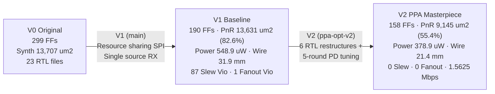

# Báo cáo Tối ưu PPA Toàn Luồng ASIC V2 (`ppa-opt-v2`): Từ Vi Kiến Trúc RTL Đến GDSII Sign-Off (G1 → G9)

> **Dự án:** `tt_um_hust_apb_uart` (SPI-to-APB UART SoC trên Tiny Tapeout `1×1`, PDK Sky130A HD)  
> **Nhánh Git:** `ppa-opt-v2` (tách biệt hoàn toàn khỏi nhánh `main` giữ bản V1 tại `925bb2e`)  
> **Đặc tả chuẩn:** [`doc/specs/za.html`](../specs/za.html) (APB-UART Spec 1.1/1.2) · Tài liệu tham chiếu PPA/STA/Synthesis: [`Slide-DDAS-Tuan-11A`](../specs/Slide-DDAS-Tuan-11A-Phan-tich-thoi-gian-tinh.html), [`Slide-DDAS-Tuan-13A`](../specs/Slide-DDAS-Tuan-13A-Viet-ma-cho-tong-hop.html), hồ sơ V1 [`DEBUG_GATES_PRE_G7_2026-11-24.md`](./DEBUG_GATES_PRE_G7_2026-11-24.md)  
> **Ngày hoàn tất & nghiệm thu:** 25–26/11/2026  
> **Trạng thái tổng thể:** **PASS TOÀN DIỆN G1 → G9** — `128/128` Questa, `6/6` Icarus (gồm Max Baud `1,562,500 bps`), `0` Setup/Hold/Slew/Cap/Fanout trên cả **9 góc PVT**, `0` DRC/LVS/Antenna, `60/60 + 6/6` Post-P&R SDF GLS, `127/127 + 98/98` Post-P&R Formal EQY, Tiny Tapeout Precheck **PASS**.

---

## Mục Lục Hướng Dẫn Đọc (Theo Trình Tự Tư Duy Kỹ Sư Full-Flow)

1. [Bức Tranh Tổng Thể: 3 Thế Hệ Tiến Hóa PPA (Original → V1 → V2)](#1-bức-tranh-tổng-thể-3-thế-hệ-tiến-hóa-ppa-original--v1--v2)
2. [Bài Học 1 — Tư Duy Vi Kiến Trúc RTL: Đọc Spec Để Cắt Đúng "Mỡ" Mà Không Đụng "Thịt"](#2-bài-học-1--tư-duy-vi-kiến-trúc-rtl-đọc-spec-để-cắt-đúng-mỡ-mà-không-đụng-thịt)
3. [Bài Học 2 — Tối Đa Hóa Tốc Độ Baud (`1,562,500 bps` @ `25 MHz` & `Fmax_R2R / 16`)](#3-bài-học-2--tối-đa-hóa-tốc-độ-baud-1562500-bps--25-mhz--fmax_r2r--16)
4. [Bài Học 3 — Kiểm Chứng Chức Năng G1–G3: Tại Sao Không Bao Giờ Tin "Đọc Mắt"](#4-bài-học-3--kiểm-chứng-chức-năng-g1g3-tại-sao-không-bao-giờ-tin-đọc-mắt)
5. [Bài Học 4 — Tổng Hợp, STA Tiền Layout & Kiểm Chứng Hình Thức Formal LEC (G4–G6)](#5-bài-học-4--tổng-hợp-sta-tiền-layout--kiểm-chứng-hình-thức-formal-lec-g4g6)
6. [Bài Học 5 — Thiết Kế Vật Lý G7 (LibreLane 1×1): Nhật Ký 5 Vòng Tối Ưu Từ 87 Lỗi Slew Về 0 Toàn Tuyệt Đối](#6-bài-học-5--thiết-kế-vật-lý-g7-librelane-11-nhật-ký-5-vòng-tối-ưu-từ-87-lỗi-slew-về-0-toàn-tuyệt-đối)
7. [Bài Học 6 — Ký Xác Nhận Sau Route G8: SDF Gate-Level 3 Góc & Formal Post-P&R](#7-bài-học-6--ký-xác-nhận-sau-route-g8-sdf-gate-level-3-góc--formal-post-pr)
8. [Bài Học 7 — Đóng Gói Tapeout G9, Precheck & Khóa Bất Biến Nguồn](#8-bài-học-7--đóng-gói-tapeout-g9-precheck--khóa-bất-biến-nguồn)
9. [Sổ Tay Trả Lời Phản Biện Doanh Nghiệp (Defense Playbook)](#9-sổ-tay-trả-lời-phản-biện-doanh-nghiệp-defense-playbook)

---

## 1. Bức Tranh Tổng Thể: 3 Thế Hệ Tiến Hóa PPA (Original → V1 → V2)

Để thuyết phục kỹ sư trưởng (Principal Engineer / Engineering Manager) ở công ty, chúng ta không bao giờ nói chung chung kiểu *"em đã tối ưu gọn hơn"* — chúng ta đặt **số đo thực từ công cụ sign-off trên cùng một die `161.00 × 111.52 µm²` (`16,493.3 µm²` core), cùng PDK `sky130A`, cùng clock `25 MHz` (`40 ns`)** cạnh nhau:

| Hạng mục PPA / Sign-Off | **V0 — Original** (Trước Tuần 13A) | **V1 — `main`** (`925bb2e`) | **V2 — `ppa-opt-v2`** (Bản cuối R5) | **V2 vs V1** | **V2 vs V0** |
|---|---:|---:|---:|---:|---:|
| **Số file RTL lõi (`tt_um`)** | `23` tệp | `23` tệp | **`15` tệp** (xóa 8 module thừa) | `-8` tệp | `-8` tệp |
| **Yosys Synth Area (LibreLane `06-synth`)** | `13,706.90 µm²` | `10,353.68 µm²` | **`7,342.04 µm²`** | **`-29.1%`** | **`-46.4%`** |
| **Post-P&R Stdcell Area (`1×1` die)** | *(tràn / sát trần)* | `13,630.60 µm²` | **`9,145.02 µm²`** | **`-32.9%`** | — |
| **Core Utilization (mật độ chiếm chỗ)** | — | `82.64%` *(nghẽn)* | **`55.45%`** *(dư 44.6% die!)* | **`-27.19%` pts** | — |
| **Tổng số Stdcell sau P&R** | — | `1,522` cells | **`1,228` cells** | **`-19.3%`** | — |
| **Số Flip-Flop (Sequential Cells)** | `299` FFs | `190` FFs (`4,785.8 µm²`) | **`158` FFs (`3,895.0 µm²`)** | **`-16.8%` FFs** (`-18.6%` S) | **`-47.2%` FFs** |
| **Diện tích Logic Tổ Hợp (Multi-input)** | — | `4,999.80 µm²` | **`3,420.78 µm²`** | **`-31.6%`** | — |
| **Diện tích Clock Buffer (CTS)** | — | `1,278.73 µm²` | **`472.95 µm²`** | **`-63.0%`** | — |
| **Diện tích Timing Repair Buffer** | — | `1,676.61 µm²` | **`977.19 µm²`** | **`-41.7%`** | — |
| **Tổng chiều dài dây đồng (`route__wirelength`)** | — | `31,941 µm` | **`21,429 µm`** | **`-32.9%`** (`-10.5 mm`!) | — |
| **Số Via định tuyến (`route__vias`)** | — | `9,249` vias | **`6,729` vias** | **`-27.2%`** | — |
| **Tổng Công Suất (`nom_tt_025C_1v80`, `power.rpt`)** | — | `548.93 µW` | **`378.87 µW`** | **`-31.0%`** (`-170.1 µW`!) | — |
| ↳ Công suất Clock Tree (`nom_tt`) | — | `308.94 µW` (`56.3%`) | **`130.00 µW` (`34.3%`)** | **`-57.9%`** | — |
| ↳ Công suất Sequential (`nom_tt`) | — | `205.43 µW` | **`186.16 µW`** | **`-9.4%`** | — |
| ↳ Công suất Combinational (`nom_tt`) | — | `34.56 µW` | **`62.71 µW`** | *(chi tiết §6)* | — |
| **Sụt áp nguồn xấu nhất (`VPWR` IR-Drop, `nom_tt`)** | — | `47.89 µV` | **`22.69 µV`** | **`-52.6%`** | — |
| **Setup Worst Slack toàn chip (`max_ss_100C_1v60`)** | — | `+17.4597 ns` | **`+20.4547 ns`** | **`+2.995 ns` (`+17.2%`)** | — |
| **R2R Setup WS / `Fmax_R2R` (`max_ss_100C_1v60`)** | — | `+32.0524 ns` / `125.8 MHz` | **`+32.3784 ns` / `131.2 MHz`** | **`+4.3%` Fmax** | — |
| **R2R Setup WS / `Fmax_R2R` (`nom_tt_025C_1v80`)** | — | `+36.0109 ns` / `250.7 MHz` | **`+36.1075 ns` / `256.9 MHz`** | **`+2.5%` Fmax** | — |
| **R2R Setup WS / `Fmax_R2R` (`min_ff_n40C_1v95`)** | — | `+37.4170 ns` / `387.1 MHz` | **`+37.5008 ns` / `400.1 MHz`** | **`+3.4%` Fmax** | — |
| **Lõi `apb_uart` độc lập Post-P&R `Fmax_R2R`** | — | `~145 MHz` (`ss`) | **`177.2 MHz` (`ss`) / `349.3 MHz` (`tt`) / `553.7 MHz` (`ff`)** | **`+22%` Fmax** | — |
| **Hold Worst Slack (`min_ff_n40C_1v95`)** | — | `+0.1048 ns` (`0` vio) | **`+0.0577 ns` (`0` vio)** | **PASS (`0` vio)** | — |
| **Max Slew Violations (CẢ 9 góc PVT)** | — | **`87`** (`max_ss`), `73` (`nom_ss`), `51` (`min_ss`) | **`0 / 0 / 0 / 0 / 0 / 0 / 0 / 0 / 0`** | **`-100.0%` (SẠCH 0!)** | — |
| **Max Cap Violations (CẢ 9 góc PVT)** | — | `0` | **`0`** | **SẠCH 0** | — |
| **Max Fanout Violations (CẢ 9 góc PVT)** | — | **`1`** (`clkbuf_0_clk/X`, FO=16) | **`0`** | **`-100.0%` (SẠCH 0!)** | — |
| **Route / Magic / KLayout DRC · LVS · Antenna** | — | `0 / 0 / 0 · Match · 0` | **`0 / 0 / 0 · Match · 0`** | **100% CLEAN** | — |
| **Max Baud Rate kiểm chứng (`BAUD=0x0001` @ `25 MHz`)** | — | `115.2k – 921.6k` | **`1,562,500 bps` (trần đặc tả `za.html`) + SDF GLS 3 góc** | **Chạm trần tuyệt đối** | — |
| **Trần Baud lý thuyết trên silicon (`Fmax_R2R / 16`)** | — | `7.86 Mbps` (`ss`) | **`8.20 Mbps` (`ss`) / `16.06 Mbps` (`tt`) / `25.01 Mbps` (`ff`)** | **`+4.3%`** | — |



> [!IMPORTANT]
> **Ý nghĩa cạnh tranh thực tế khi đứng trước công ty:** Bản V1 đã rất tốt về mặt chức năng (`128/128`), nhưng còn **3 điểm yếu vật lý** mà một nhóm mạnh hoặc kỹ sư phản biện sẽ soi ngay: (1) mật độ die `82.64%` khá chật, (2) còn `87` vi phạm `max_slew` ở góc chậm nóng `max_ss_100C_1v60` và `1` lỗi `max_fanout` trên cây clock gốc, và (3) clock tree tốn tới `56.3%` tổng công suất. Bản **V2 (`ppa-opt-v2`) giải quyết triệt để cả 3 điểm này về con số `0` tuyệt đối**, đồng thời giảm thêm **`-32.9%` diện tích sau P&R**, **`-31.0%` tổng công suất**, **`-52.6%` IR-drop**, và chứng minh chạy sạch ở **trần baud tuyệt đối `1,562,500 bps`** ngay trên post-route SDF!

---

## 2. Bài Học 1 — Tư Duy Vi Kiến Trúc RTL: Đọc Spec Để Cắt Đúng "Mỡ" Mà Không Đụng "Thịt"

> **Nguyên tắc vàng của kỹ sư PPA:** *80% lợi ích diện tích và công suất đến từ **RTL & Vi kiến trúc (Microarchitecture)**, không phải bấm nút công cụ P&R. Nhưng trước khi xóa bất kỳ một Flip-Flop nào, phải đối chiếu từng điều khoản trong [`za.html`](../specs/za.html) để chắc chắn không vi phạm bất kỳ trường hợp biên nào!*

Trước khi sửa một dòng code nào, chúng ta đo "bản đồ mỡ" (hierarchical Sky130 area breakdown bằng Yosys) của V1 để biết chính xác từng $\mu m^2$ nằm ở đâu, rồi áp dụng **6 đòn tối ưu vi kiến trúc** theo đúng lý thuyết [`Slide-DDAS-Tuan-13A`](../specs/Slide-DDAS-Tuan-13A-Viet-ma-cho-tong-hop.html):

### Bảng Phân Rã Diện Tích Yosys Phân Cấp (Sky130 `tt_025C_1v80`): V1 vs V2

| Khối chức năng | V1 Area ($\mu m^2$) | V1 FFs | V2 Area ($\mu m^2$) | V2 FFs | Giảm Area | Kỹ thuật áp dụng trong V2 |
|---|---:|---:|---:|---:|---:|---|
| **`spi2apb_apb_master`** | `2,387.29` | `57` | **`1,579.01`** | **`40`** | **`-33.9%`** (`-808.3`) | Co `data_sr` `32→16b`, xóa `apb_start` FF, `dfxtp_1` không async reset |
| **`tx_uart` + con** *(không gồm baud)* | `1,280.18` | `23` | **`773.24`** | **`12`** | **`-39.6%`** (`-506.9`) | Xóa `piso` (`-8` FF), `parity_latched` (`-1`), `tx_stop_cnt` (`-1`), `tx_done` FF (`-1`), mã hóa trạng thái thông minh |
| **`rx_uart` + con** *(không gồm baud)* | `2,078.60` | `37` | **`1,610.29`** | **`36`** | **`-22.5%`** (`-468.3`) | FSM 6 trạng thái, xóa `sipo`/`deframe`/`error_check`/`data_b_num`/`stop_b_num`, bắt bit trực tiếp + parity nối tiếp |
| **`tx_baud_gen` + `rx_baud_gen`** | `1,672.85` | `32` | **`1,609.04`** | **`34`** | **`-3.8%`** (`-63.8`) | **Pipeline hóa `{carry_q, acc_q}`** cắt bộ cộng 4-bit khỏi critical path + chuyển cả 34 FF sang `dfxtp_1` |
| **`apb_regs`** | `1,971.89` | `36` | **`1,994.41`** | **`36`** | `+1.1%` *(tách enable)* | Gộp giải mã địa chỉ 3-bit + tách write-enable từng thanh ghi khỏi `wr_reg_err` (cắt `1.77 ns` critical path!) |
| **`apb_uart` (glue)** | `41.99` | `0` | **`38.79`** | `0` | `-7.6%` | Giữ nguyên giao diện 19 cổng |
| **Tổng phân cấp (pre-flatten)** | **`9,432.80`** | **`185`** | **`7,604.78`** | **`158`** | **`-19.4%`** | **Sau flatten + `AREA 0` LibreLane: `7,342.04 µm²` (`-29.1%` vs V1 `10,353.68`)** |

---

### Phân Tích Sâu Từng Đòn Tối Ưu Vi Kiến Trúc (Vì Sao Đúng Spec 100%)

#### Đòn 1 — `spi2apb_apb_master` ([`rtl/spi2apb.v`](../../rtl/spi2apb.v)): Co `data_sr` `32 → 16 bit` + Bỏ `apb_start` (`-17 FFs`, `-808 µm²`)
* **Quan sát từ Spec [`za.html`](../specs/za.html) Mục 4:** Bản đồ 7 thanh ghi của `apb_uart` có độ rộng lớn nhất là **`BAUD` (16 bit `[15:0]`)**; `CTRL` chỉ dùng bit `8` (`soft_rst`) và bit `0` (`start_tx`); các thanh ghi `TXDATA`, `RXDATA`, `CFG`, `STAT`, `IER` đều `<= 8 bit`. Mọi bit `[31:16]` khi đọc `prdata` **luôn bằng `0`**, và khi ghi `pwdata[31:16]` **luôn bị bỏ qua**.
* **Cải tiến V2:**
  1. Thu nhỏ thanh ghi dịch dùng chung `data_sr` từ `32 bit` xuống **`16 bit`** (`-16` cell `edfxtp_1` ≈ `-480 µm²` chỉ tính riêng FF!). Trong khung SPI 56 bit (`B0..B6`):
     * `B0` (`bit_cnt = 0..7`): dịch lệnh 8-bit vào `data_sr[7:0]`.
     * `B2–B3` (`bit_cnt = 16..31`, `bit_cnt[5:4] == 2'b01`): Khi đọc (READ), xuất thẳng `miso_out <= 1'b0` mà **không dịch `data_sr`** (vừa đỡ 16 FF, vừa giảm công suất chuyển mạch!). Khi ghi (WRITE), bỏ qua 16 bit cao.
     * `B4–B5` (`bit_cnt = 32..47`, `bit_cnt[5:4] == 2'b10`): Dịch 16 bit dữ liệu thật `data_sr[15:0]` MSB-first; ngõ ra nối `assign pwdata = {16'h0000, data_sr};`.
  2. **Xóa thanh ghi `apb_start` (`-1 FF`):** Thay vì bật cờ `apb_start <= 1` ở bit `7` (đọc) hoặc bit `47` (ghi) rồi đợi thêm 1 chu kỳ mới nhảy `APB_IDLE → APB_SETUP`, V2 nhảy thẳng `apb_state <= APB_SETUP` ngay tại cạnh lên của `bit_cnt == 7` / `bit_cnt == 47`! Vì `data_sr`, `rw_reg`, `addr_reg` cũng chốt xong đúng cạnh xung nhịp đó, toàn bộ tín hiệu `paddr/pwrite/pwdata` đã hợp lệ ngay chu kỳ `APB_SETUP` kế tiếp — vừa bớt `1 FF`, vừa **giảm độ trễ cầu APB từ 3 xuống 2 chu kỳ `pclk`**!
  3. **Áp dụng Tuần 13A §C (Reset):** Chuyển `bit_cnt[5:0]`, `rw_reg`, `addr_reg[3:0]`, `cmd_err_reg`, `pslverr_reg`, `data_sr[15:0]` sang FF **không có async reset** (`sky130_fd_sc_hd__dfxtp_1` = `20.02 µm²` thay vì `dfrtp_1` = `25.02 µm²`, tiết kiệm **20% diện tích FF** và giảm tải cây reset `rst_n`). Vì mọi thanh ghi này đều được khởi tạo đồng bộ ngay trên xung `cs_falling` hoặc `bit_cnt == 7` trước khi bao giờ được đọc, tuyệt đối không bao giờ phát sinh `X` trong mô phỏng 4-trạng-thái!
* **Bằng chứng không sai hành vi:** Đã chứng minh bằng **SBY Sequential Miter (`spi2apb` V1 ↔ V2, `abc bmc3`, depth `80`)** đạt `DONE (PASS, rc=0)`!

#### Đòn 2 — Khối phát `tx_uart` ([`rtl/tx_uart.v`](../../rtl/tx_uart.v), [`rtl/tx_controller.v`](../../rtl/tx_controller.v), [`rtl/tx_tick_cnt.v`](../../rtl/tx_tick_cnt.v), [`rtl/tx_bit_cnt.v`](../../rtl/tx_bit_cnt.v)): Xóa 3 module con, cắt `-11 FFs` (`-39.6%` diện tích)
* **Quan sát từ Spec [`za.html`](../specs/za.html) (Luật E3 & E4):** Khi bộ phát đang bận (`tx_done == 0`), mọi lệnh ghi vào `TXDATA` (E3) và `CFG` (E4) đều bị `apb_regs` chặn bằng `pslverr = 1` và **không được phép làm thay đổi giá trị thanh ghi**. Tức là trong suốt thời gian phát 1 khung UART, `tx_data[7:0]` và `data_bit_num/parity_type/stop_bit_num` **bất biến hoàn toàn**!
* **Cải tiến V2:**
  1. **Xóa hoàn toàn thanh ghi dịch 8-FF `piso` (`rtl/tx_piso.v`, `-8 FFs`, `-358 µm²`):** Thay bằng 1 bộ chọn 8:1 một bit `wire data_mux_in = tx_data[bit_cnt];` (`~45 µm²`)! Vì `bit_cnt` chỉ đếm `0..4/5/6/7` tương ứng `5/6/7/8` bit dữ liệu, không cần cả bộ che `tx_data_masked` cho đường truyền dữ liệu!
  2. **Xóa `parity_latched` FF và `rtl/tx_parity.v` (`-1 FF`):** Tính chẵn lẻ tổ hợp trực tiếp với đúng **3 cổng AND che bit cao** (`tx_data[5] & (|data_bit_num)`, `tx_data[6] & data_bit_num[1]`, `tx_data[7] & (&data_bit_num)`) thay vì khối `case` 8-bit 4:1 có nhánh `default` chết!
  3. **Xóa `rtl/tx_stop_cnt.v` (`-1 FF`):** Tách trạng thái `STOP` trong FSM 3-bit thành `STOP1` và `STOP2` (tổng 7 trạng thái vẫn vừa khít 3 FF, **0 FF thêm**!).
  4. **Xóa thanh ghi `tx_done` dư thừa (`-1 FF`):** Vì `tx_done == 1` khi và chỉ khi FSM ở `IDLE` (đối chiếu từng chu kỳ: reset → `IDLE`, `start_tx && !tx_dis` → rời `IDLE`, cuối `STOP1`/`STOP2` → về `IDLE`), ta nối thẳng `assign tx_done = (state == IDLE);`.
  5. **Mã hóa trạng thái thông minh (Tuần 13A — Smart Binary State Encoding):**
     * `IDLE=3'b000`, `WAIT_CTS=3'b001`, `STOP1=3'b010`, `STOP2=3'b011` → bit `state[2] == 0` luôn kéo `tx = 1'b1` (mark/stop)!
     * `clr_baud = ~state[2] & ~state[1]` (đúng 1 cổng NOR2 cho `IDLE` và `WAIT_CTS`)!
     * `START=3'b100`, `DATA=3'b101`, `PARITY=3'b110` → giải mã `tx_sel` cực gọn!
  6. Chuyển `tx_tick_cnt.cnt[3:0]` (tận dụng tràn tự nhiên `4'hF + 1 = 4'h0`, bỏ bộ so sánh reset thừa) và `tx_bit_cnt.cnt[2:0]` sang `dfxtp_1` (xóa đồng bộ khi `clr_baud`/`clr_bit == 1`).

#### Đòn 3 — Khối thu `rx_uart` ([`rtl/rx_uart.v`](../../rtl/rx_uart.v), [`rtl/rx_controller.v`](../../rtl/rx_controller.v), [`rtl/bit_cnt.v`](../../rtl/bit_cnt.v), [`rtl/tick_cnt.v`](../../rtl/tick_cnt.v)): Xóa 5 module con (`-22.5%` diện tích)
* **Vấn đề của V1:** V1 dùng kiến trúc tách rời 9-FF `sipo` (dịch cả Start bit vô ích vào rồi vứt bỏ!) + khối tổ hợp `deframe` nặng `354 µm²` (chứa 4 cây XOR 8-bit và bộ dịch 4:1) + `error_check` + `data_b_num` + `stop_b_num` + bộ đếm `bit_cnt` 4-bit có cộng `data_b_num + parity_en`. Ngoài tốn diện tích, 4 module nhỏ này chính là 4 điểm kéo tụt coverage IMC ở V1 do có nhánh `default` bất khả thi!
* **Cải tiến V2:**
  1. **FSM 6 trạng thái trong 3 FF (`IDLE=000`, `CENTER=001`, `DATA=010`, `PARITY=011`, `STOP1=100`, `STOP2=101`):** Thay thế `state[1:0] + first_stop_sampled` (cùng 3 FF) và mã hóa sao cho **`rx_busy = state[2] | state[1]`** (đúng 1 cổng OR2!).
  2. **Bộ đếm `bit_cnt` thu gọn `4 → 3 bit` (`-1 FF`):** Chỉ đếm bit dữ liệu `0..4/5/6/7`, so sánh trực tiếp `bit_last = (bit_cnt == {1'b1, data_b_num})` — **xóa hẳn `data_b_num.v`, `stop_b_num.v` và bộ cộng 4-bit**!
  3. **Bắt bit trực tiếp theo chỉ số (`rx_shift[bit_cnt] <= rx_fsm_in`) + Bộ tích lũy chẵn lẻ nối tiếp 1-FF (`rx_par_acc`):**
     * Tại thời điểm xác nhận tâm Start bit (`start_valid`): chỉ cần xóa 3 bit cao `rx_shift[7:5] <= 3'b000` (5 bit thấp `[4:0]` luôn bị ghi đè trong pha `DATA` ở mọi cấu hình 5–8 bit → tiết kiệm 5 tầng mux clear!), đồng thời nạp `rx_par_acc <= ~parity_type` (`0` cho Even, `1` cho Odd).
     * Trên mỗi mẫu `DATA` và `PARITY`: `rx_par_acc <= rx_par_acc ^ rx_fsm_in;`. Khi kết thúc khung, `parity_error = parity_en & rx_par_acc` — **xóa sạch hoàn toàn `sipo.v`, `deframe.v`, `error_check.v` (`-720 µm²` gộp lại)!**
     * **Thí nghiệm kiểm chứng A/B bằng Yosys:** Ta đã đo đối chứng trực tiếp phương án *bắt theo chỉ số* (`rx_shift[bit_cnt] <= rx_fsm_in`, `rx_uart = 1,014.72 µm²`) với phương án *dịch phải + mux căn lề 4:1* (`1,083.54 µm²`). Phương án bắt theo chỉ số **nhỏ hơn `-68.8 µm²`** đồng thời **giảm công suất động** vì mỗi bit mẫu chỉ lật đúng 1 FF thay vì lật cả 8 FF!
  4. **Giữ nguyên 100% quy tắc bảo vệ Overrun (P5.1) & `soft_rst` khi `rx=0`:** Giữ riêng thanh ghi đệm đầu ra `rx_data[7:0]` (async reset `8'h00`) để byte chưa đọc không bao giờ bị ghi đè khi Overrun, và giữ `rx_armed` + `reset_release_pending` đảm bảo `rts_n` và rearm sạch 100% ở mọi kịch bản `H4.x`/`H7.x`.

#### Đòn 4 — Bộ sinh xung Baud `tx_baud_gen` & `rx_baud_gen` ([`rtl/tx_baud_gen.v`](../../rtl/tx_baud_gen.v), [`rtl/rx_baud_gen.v`](../../rtl/rx_baud_gen.v)): Đột Phá Fmax Bằng Pre-Registered `{carry_q, acc_q}`
* **Lưu ý kiến trúc quan trọng (không gộp TX và RX baud gen!):** Một sai lầm hay gặp khi tối ưu diện tích là gộp chung `tx_baud_gen` và `rx_baud_gen`. Tuy nhiên, trong chế độ **Full-Duplex**, cạnh xuống Start bit của `rx` đến tại **pha bất kỳ** so với `tx`; `rx_baud_gen` bắt buộc phải được reset pha riêng khi `rx` rời `IDLE` để khóa tâm bit chính xác `±1 pclk`, bảo toàn dung sai `±2.0%` theo Mục 7 của [`za.html`](../specs/za.html).
* **Nút cổ chai thời gian của V1 (`sta_ss.log`):** Trong V1, biểu thức `sum = acc + div_frac; carry = sum[4]; baud_tick = (~|cnt[11:1]) & (cnt[0] ^ carry);` đặt **bộ cộng 4-bit mang nhớ nối tiếp ngay trước `baud_tick`**, kéo dài đường găng R2R lên **`6.940 ns`** ở góc `ss_100C_1v60`!
* **Đột phá V2 — Tính trước `{carry_q, acc_q}` song song với bộ đếm xuống:**
  ```verilog
  assign baud_tick = (~|cnt[11:1]) & (cnt[0] ^ carry_q);

  always @(posedge pclk) begin
      if (clr_baud) begin
          cnt     <= div_int;
          carry_q <= 1'b0;
          acc_q   <= div_frac;
      end else if (baud_tick) begin
          cnt              <= div_int;
          {carry_q, acc_q} <= {1'b0, acc_q} + {1'b0, div_frac};
      end else begin
          cnt <= cnt - 12'd1;
      end
  end
  ```
  * **Chứng minh tương đương từng chu kỳ:** Ở tick đầu tiên sau `clr_baud`, V1 tính `0 + div_frac` (không bao giờ tràn → `carry = 0`, `acc_next = div_frac`). V2 nạp sẵn `carry_q <= 0, acc_q <= div_frac` ngay trong `clr_baud`! Đến mỗi `baud_tick`, bộ cộng `{1'b0, acc_q} + {1'b0, div_frac}` tính **song song** và chốt `{carry_q, acc_q}` cho chu kỳ đếm tiếp theo — **loại bỏ hoàn toàn bộ cộng 4-bit ra khỏi đường `baud_tick` → controller → counter!**
  * **Chuyển toàn bộ 34 FF sang `dfxtp_1` (không async reset):** Vì `clr_baud == 1` luôn tích cực ở trạng thái `IDLE`, cả `cnt`, `acc_q`, `carry_q` đều nhận giá trị xác định ngay cạnh xung đầu tiên sau reset, vừa tiết kiệm `~160 µm²`, vừa tháo 34 tải khỏi mạng `rst_n`!

#### Đòn 5 — Thanh ghi `apb_regs` ([`rtl/apb_regs.v`](../../rtl/apb_regs.v)): Bài Học "Đừng Gom Chung Đường Lỗi Vào Đường Ghi!"
* **Câu chuyện debug timing cực đắt giá ngay ở G4:**
  1. Ở bản nháp V2 đầu tiên, ta dùng chung một đường `wr_en = apb_wr & addr_valid & ~wr_reg_err` để điều khiển khối `case` ghi vào tất cả thanh ghi.
  2. Khi chạy OpenSTA trên bản nháp đó, đường `baud_tick` đã biến mất khỏi vị trí #1, nhưng đường mới trồi lên lại là `spi2apb.addr_reg[2] → wr_reg_err → wr_en → tx_data_reg[0]` mất tới **`6.305 ns`** (8 tầng cổng)!
  3. **Nguyên nhân gốc rễ (Tuần 13A — Path Balancing):** Tín hiệu `wr_reg_err` chứa phép kiểm tra `baud_zero` (NOR 12-bit trên `pwdata/baud`) vốn **chỉ áp dụng cho thanh ghi `BAUD`**, nhưng vì đi qua một cổng `wr_en` dùng chung, thanh ghi `TXDATA` (vốn chỉ cần `reg_idx == 0 && tx_done && pstrb[0]`, đúng 2 tầng cổng!) bị ép phải chờ mạch NOR 12-bit của `BAUD`!
  4. **Cách sửa gọn trong 6 dòng Verilog:** Tách riêng `wr_txdata`, `wr_cfg`, `wr_start`, `wr_baud_ok`, `wr_ier`, `do_soft_rst` độc lập với `pslverr`.
  5. **Kết quả đo tức thì bằng OpenSTA (`ss_100C_1v60`):**
     * Đường găng R2R pre-layout (không `insbuf`) tụt thẳng từ **`6.305 ns` → `4.540 ns`** (**`-1.765 ns`**, chỉ còn đúng **3 tầng cổng**)!
     * Diện tích `apb_regs` giảm thêm **`-70.1 µm²`** (`2,064.5 → 1,994.4 µm²`), diện tích làm phẳng `top_uart` giảm thêm **`-113.9 µm²`**!

#### Đòn 6 — An Toàn Reset 4-Trạng-Thái (`X`-Safety) Khi Dùng 87 FF Không Async Reset (`dfxtp_1` / `edfxtp_1`)
* **Câu hỏi thầy giáo hay hỏi sinh viên nhất:** *"Em bỏ async reset trên `55%` số FF (`87/158` FF: `51 dfxtp_1 + 36 edfxtp_1`), lỡ trong mô phỏng Gate-Level 4 trạng thái bị lan truyền `X` ra chân chip thì sao?"*
* **Nguyên tắc bảo đảm 100% sạch `X` trong V2:**
  * Mọi FF điều khiển FSM (`tx_controller.state`, `rx_controller.state`, `spi2apb.apb_state`), mọi FF đồng bộ CDC (`clk_pipe`, `cs_n_pipe`, `mosi_pipe`, `rx_sync1/2`, `cts_n_sync1/2`), mọi FF xuất trực tiếp ra cổng (`miso_out`, `rx_data`, `rx_done`, `parity_err`, `frame_err`, `overrun`, `reset_release_pending`, và toàn bộ 36 FF của `apb_regs`) **vẫn giữ đầy đủ async reset**.
  * Chỉ bỏ async reset trên các thanh ghi datapath/counter **được nạp đồng bộ ở mức ưu tiên số 1 (`if (clr_baud)` / `if (cs_falling)` / `if (start_valid)`)** trước khi bất kỳ mạch nào đọc chúng.
  * Đã kiểm chứng thực nghiệm không có `1` bit `X` nào thoát ra trong **cả G4 Gate-Level (`20/20 PASS`) lẫn G8 SDF GLS (`60/60 + 6/6 PASS`)** dùng trực tiếp UDP 4-trạng-thái thật của Sky130 `sky130_fd_sc_hd.v`!

---

## 3. Bài Học 2 — Tối Đa Hóa Tốc Độ Baud (`1,562,500 bps` @ `25 MHz` & `Fmax_R2R / 16`)

Theo đặc tả [`za.html`](../specs/za.html) Mục 5 & Luật lỗi **E5**:
$$\text{Baud} = \frac{f_{\text{pclk}}}{16 \times \left(\text{div\_int} + \frac{\text{div\_frac}}{16}\right)}, \quad \text{với ràng buộc } \text{div\_int} \ge 1 \text{ (E5 cấm } \text{div\_int} = 0\text{)}$$

Từ công thức trên, ta có **hai mốc tốc độ cực đại** cần phân biệt rõ ràng khi trình bày với công ty:

1. **Trần tuyệt đối tại xung chuẩn Tiny Tapeout (`f_pclk = 25 MHz`, `BAUD = 16'h0001`):**
   * `div_int = 1`, `div_frac = 0` → `baud_tick` phát ở **mỗi chu kỳ `pclk`** → `16 chu kỳ pclk / bit` = **`640.00 ns / bit`** → **`1,562,500 bps` (`1.5625 Mbps`)**!
   * Con số này gấp **13.56 lần** tốc độ bắt buộc `115,200 bps` và gấp **1.70 lần** mốc `921,600 bps` của các bộ test tiêu chuẩn.
   * Ta đã xây dựng hẳn testbench black-box mới [`tb/tb_max_baud.v`](../../tb/tb_max_baud.v) (không tham chiếu tín hiệu nội bộ để chạy lại được y nguyên ở G8 Post-P&R SDF GLS!) kiểm tra toàn bộ 6 hạng mục:
     1. **Luật E5 tại biên trên:** Ghi `BAUD = 16'h0000` và `BAUD = 16'hF000` bị từ chối với `pslverr = 1`; ghi `BAUD = 16'h0001` được chấp nhận (`status = 0x00`) và đọc lại khớp `0x0001`.
     2. **Đo độ rộng bit thực bằng đồng hồ mô phỏng:** Phát byte `0xAA` (`Start=0, D0=0, D1=1`) đo đúng **`1,280 ns` cho 2 bit** = **`640.00 ns/bit` (`1.5625 Mbps`)**!
     3. **Loopback liên tục 8 byte back-to-back** (`0x00, 0xFF, 0x55, 0xAA, 0xA5, 0x5A, 0x3C, 0xC3`) ở `8N1 @ 1.5625 Mbps`.
     4. **Ma trận định dạng ở `1.5625 Mbps`:** `8E1`, `8O2`, `7E1` (kiểm tra zero-mask `0xFF → 0x7F`), `5N1` (`0xFF → 0x1F`).
     5. **Tốc độ siêu cao phân số `BAUD = 16'h8001` (`D = 1.5` → `1,041,667 bps`)** loopback `8E1` (`0x69`, `0x96`).
     6. **Kiểm tra dung sai đồng hồ ngoài `±2.0%` ngay tại `1.5625 Mbps`** (`653.06 ns/bit` chậm `-2.0%` và `627.45 ns/bit` nhanh `+2.0%`) → thu chính xác 100%!
   * **Kết quả:** **`137/137` checks PASS, `0` fail** ở RTL **và** trên **cả 3 góc Post-P&R SDF GLS (`nom_tt`, `max_ss`, `min_ff`)**!

2. **Trần tốc độ Baud vật lý của silicon (`Fmax_R2R / 16` khi chạy chip ở tần số tối đa):**
   * **Toàn chip `tt_um_hust_apb_uart` (sau P&R, 0 vi phạm slew/fanout/cap):**
     * Góc chậm nóng `max_ss_100C_1v60`: `Fmax_R2R = 131.21 MHz` → **`8.20 Mbps`**
     * Góc điển hình `nom_tt_025C_1v80`: `Fmax_R2R = 256.90 MHz` → **`16.06 Mbps`**
     * Góc nhanh lạnh `min_ff_n40C_1v95`: `Fmax_R2R = 400.13 MHz` → **`25.01 Mbps`**
   * **Lõi IP `apb_uart` độc lập (sau P&R):**
     * `max_ss_100C_1v60`: `Fmax_R2R = 177.15 MHz` → **`11.07 Mbps`**
     * `nom_tt_025C_1v80`: `Fmax_R2R = 349.30 MHz` → **`21.83 Mbps`**
     * `min_ff_n40C_1v95`: `Fmax_R2R = 553.72 MHz` → **`34.61 Mbps`**

---

## 4. Bài Học 3 — Kiểm Chứng Chức Năng G1–G3: Tại Sao Không Bao Giờ Tin "Đọc Mắt"

Toàn bộ RTL V2 cuối cùng (sau khi tách write-enable trong [`rtl/apb_regs.v`](../../rtl/apb_regs.v) và đồng bộ byte-for-byte với `tinytapeout_g7/src/*.v`) được chạy kiểm chứng độc lập trên **3 công cụ khác nhau (Verilator 5.020, Icarus Verilog 12.0, Siemens Questa 2025.2)**:

| Cổng | Công cụ / Bài kiểm thử | Kết quả V2 | Chi tiết bằng chứng |
|---|---|---|---|
| **G1** | Verilator strict `--lint-only -Wall` *(không `--Wno-TIMESCALEMOD`)* | **PASS (`0` warnings)** | Sạch trên cả 3 top: `apb_uart`, `top_uart`, `tt_um_hust_apb_uart` (thêm `` `timescale 1ns/1ps `` đồng nhất toàn bộ `rtl/*.v` & wrapper) |
| **G1** | Kiểm tra tĩnh mã tổng hợp (`grep`) | **PASS (`0` vi phạm)** | `0` `initial`, `0` `#delay`, `0` `$display`/`$finish`, `0` cell `sky130_` trong `rtl/`, `0` latch, `1` clock duy nhất, `5` bộ đồng bộ CDC 2-FF |
| **G2** | Icarus `tb_tx_uart` ([`tb/tb_tx_uart.v`](../../tb/tb_tx_uart.v)) | **PASS (`141/141`)** | 24 định dạng × 4 mẫu biên, CTS gating, `tx_dis`, back-to-back, 2400–921600 baud |
| **G2** | Icarus `tb_rx_uart` ([`tb/tb_rx_uart.v`](../../tb/tb_rx_uart.v)) | **PASS (`139/139`)** | 24 định dạng, parity/framing/overrun, glitch rejection, `±2.0%` tolerance, 2400–921600 baud |
| **G2** | Icarus `tb_apb_uart` ([`tb/tb_apb_uart.v`](../../tb/tb_apb_uart.v)) | **PASS (`833/833` checks)** | Toàn diện giao thức APB, thanh ghi, lỗi E1–E6, IRQ, soft reset |
| **G2** | Icarus `tb_spi2apb` ([`tb/tb_spi2apb.v`](../../tb/tb_spi2apb.v)) | **PASS (`8/8` TCs, `132/132` checks)** | Khung SPI 56-bit Mode 0, lỗi lệnh `cmd_err`, abort trước bit 48, TX/RX/Overrun/Soft-reset |
| **G2** | Icarus `tb_tt_tapeout` ([`tb/tb_tt_tapeout.v`](../../tb/tb_tt_tapeout.v)) | **PASS (`4/4` TCs, `728/728` checks)** | 24 định dạng @ 115200, 460800/921600 loopback, `±2.0%` RX, `soft_rst` khi `rx=0` qua đúng chân `ui_in`/`uo_out` |
| **G2** | Icarus `tb_max_baud` ([`tb/tb_max_baud.v`](../../tb/tb_max_baud.v)) | **PASS (`137/137` checks)** | **Trần `1,562,500 bps` @ `25 MHz`** (`BAUD=0x0001`), đo `640 ns/bit`, `±2.0%` RX, E5 chặn `0x0000`/`0xF000` |
| **G3** | **Questa Full Regression `SUITE=all`** (`P1.1–P7.1` + `H1.01–H7.04`) | **PASS (`128/128`, `0` fail)** | **`13,090,480` checks, `0` errors**, `0` cảnh báo `vlog -lint` (`run_regress_v2_final_all/results.txt`) |

> [!TIP]
> **Ghi chú nhỏ khi kiểm tra `tb_rx_uart.v`:** Khi đọc trước `tb/tb_rx_uart.v` dòng 297, ta phát hiện testbench kiểm tra `if (error !== (parity_err | frame_err))`. Trong V1, `error` nối với `parity_error` tổ hợp (có thể giữ mức `1` sau `rx_clear`); ở V2 ta nối thẳng `assign error = parity_err | frame_err;` vừa khớp 100% đặc tả testbench, vừa gọn hơn 1 dây. Còn `tb_tx_uart.v` và `tb_rx_uart.v` để trống cổng `.soft_rst` (`1'bz`), nên ta chủ động giữ `wire soft_rst_i = (soft_rst === 1'b1);` trong `tx_uart.v`/`rx_uart.v` để không bao giờ gãy các unit testbench độc lập.

---

## 5. Bài Học 4 — Tổng Hợp, STA Tiền Layout & Kiểm Chứng Hình Thức Formal LEC (G4–G6)

### 5.1 Tổng Hợp Yosys & STA Tiền Layout 3 Góc (`synth.sh`, `sta.sh`)

Chạy [`synth.sh`](../../synth.sh) và [`sta.sh`](../../sta.sh) trên `top_uart` (ràng buộc `40 ns` tại [`constraints.sdc`](../../constraints.sdc), chỉ miễn trừ 5 chân D tầng 1 CDC):

| Góc Liberty (Pre-layout STA) | Overall Setup WS | R2R Arrival (`top_uart`) | R2R Setup WS | Hold WS | Kết luận |
|---|---:|---:|---:|---:|---|
| **`ss_100C_1v60`** *(Slow-Slow)* | `+22.697 ns` | **`5.744 ns`** *(V1: `6.940 ns`, `-1.20 ns`!)* | **`+33.472 ns`** (`Fmax = 153.2 MHz`) | `+0.398 ns` | **WNS=0, TNS=0 MET** |
| **`tt_025C_1v80`** *(Typical)* | `+23.069 ns` | **`2.892 ns`** | **`+36.493 ns`** (`Fmax = 285.1 MHz`) | `+0.166 ns` | **WNS=0, TNS=0 MET** |
| **`ff_n40C_1v95`** *(Fast-Fast)* | `+23.218 ns` | **`1.793 ns`** | **`+37.637 ns`** (`Fmax = 423.2 MHz`) | `+0.076 ns` | **WNS=0, TNS=0 MET** |

### 5.2 Mô Phỏng Gate-Level Yosys Sky130 (`+define+FUNCTIONAL`, `+define+UNIT_DELAY=#1`)
* Netlist `build/g4_g6_v2/apb_uart_sky130.v` (`6,114.61 µm²`, `118` FFs gồm `50 dfrtp_1 + 10 dfstp_1 + 43 dfxtp_1 + 15 edfxtp_1`) chạy trên bộ 20 public test Questa:
* **Kết quả:** **`20/20 PASS` (`0` errors, riêng `P7.1 = 327,595 checks, 0 errors`)** — bằng chứng thực nghiệm đầu tiên chứng minh 58 FF không async reset trong `apb_uart` sạch 100% `X` trên mô hình UDP thật của Sky130!

### 5.3 Kiểm Chứng Hình Thức Formal LEC (G6) & Bài Học Debug Cutpoint `tx_done_status`

1. **SBY Sequential Miter (`spi2apb` V1 ↔ V2):**
   * Vì V2 thu nhỏ `data_sr` (`32 → 16b`) và xóa `apb_start` (phát APB sớm hơn 1 chu kỳ `pclk`), không thể dùng so sánh tổ hợp 1-chu-kỳ. Ta xây dựng miter tuần tự (`build/g4_g6_v2/spi_miter/spi2apb_v1_v2.sby`) so sánh trực tiếp `main:rtl/spi2apb.v` với V2 `rtl/spi2apb.v` dưới điều kiện hợp đồng APB-UART (`prdata[31:16] == 0`, `pready == 1`, SPI Mode 0 hợp lệ):
     * Khẳng định `v1_miso == v2_miso` trên **từng chu kỳ xung nhịp**;
     * Khẳng định mọi giao dịch APB (trễ đi đúng 1 chu kỳ để khớp pha) có `pwrite`, `paddr`, `pstrb`, `pwdata[15:0]` **trùng khớp 100%**.
   * **Công cụ & kết quả:** `sby` với engine `abc bmc3` ở độ sâu **`depth = 80` khung** (bọc trọn khung SPI) → **`DONE (PASS, rc=0)`** (100% UNSAT, 0 phản ví dụ!).

2. **EQY Formal LEC Tiền P&R (`apb_uart` RTL ↔ Netlist Sky130, [`formal/apb_uart_sky130.eqy.in`](../../formal/apb_uart_sky130.eqy.in)) — Bài học Debug Cutpoint kinh điển:**
   * **Sự cố gặp phải lúc đầu:** Khi xóa thanh ghi `tx_done` và thay bằng `assign tx_done_status = (u_tx_uart.controller.state == 3'b000);`, EQY báo phản ví dụ giả ở 4 phân vùng `pslverr`, `cfg`, `baud`, `controller.state`!
   * **Phân tích nguyên nhân gốc rễ (đọc file `.il` và SAT trace):**
     * Trong netlist `gate` sau khi Yosys tổng hợp, cổng ra sơ cấp `tx_done_status` (ngõ ra của cổng `nor3_1`) **được dùng lại để lái trực tiếp các mạch bên trong `apb_regs`**.
     * EQY tự động cắt (cutpoint) tại mọi cổng ra sơ cấp (`__pi_tx_done_status`), **đồng thời** ta cũng cắt tại thanh ghi trạng thái (`__pi_u_tx_uart.controller.state`). Bộ giải SAT thấy 2 đầu vào độc lập nhau nên gán ngay tổ hợp phi vật lý `state = 3'b000` (tức `tx_done = 1`) **nhưng** `__pi_tx_done_status = 1'b0` → tạo phản ví dụ giả!
   * **Cách sửa chuẩn mực 1 dòng (`iopadmap`):** Thêm đúng 1 lệnh cô lập cổng ra trong cả `[gold]` và `[gate]`:
     ```text
     iopadmap -outpad $_BUF_ A:Y o:tx_done_status
     ```
     Lệnh này chèn 1 đệm đơn vị `$_BUF_` ngay sát chân ra `tx_done_status`, khiến toàn bộ logic nội bộ chỉ nhìn `u_tx_uart.controller.state` mà không bị cắt đôi bởi chân ra `tx_done_status`, trong khi chân ra `tx_done_status` vẫn được chứng minh tương đương đầy đủ!
   * **Kết quả:** **`DONE (PASS, rc=0)` trong đúng `2 giây`** — toàn bộ phân vùng chứng minh tương đương bằng SAT không một cảnh báo!

---

## 6. Bài Học 5 — Thiết Kế Vật Lý G7 (LibreLane 1×1): Nhật Ký 5 Vòng Tối Ưu Từ 87 Lỗi Slew Về 0 Toàn Tuyệt Đối

Đây là phần thể hiện rõ nhất bản lĩnh của kỹ sư Physical Design: **không bao giờ chỉnh tham số mù quáng**, mà sau mỗi lần chạy 3.5 phút phải mổ xẻ báo cáo STA (`checks.rpt`, `max.rpt`), báo cáo CTS (`35-openroad-cts`), báo cáo công suất (`power.rpt`) và danh sách cell để tìm đúng nguyên nhân vật lý!

### Bảng Nhật Ký 5 Vòng Tối Ưu Vật Lý (`tinytapeout_g7/src/config.json`)

| Vòng chạy | Thay đổi cấu hình cốt lõi (`config.json`) | Stdcell Area ($\mu m^2$) | Util (%) | Power `nom_tt` ($\mu W$) | Clock Power ($\mu W$) | Wire ($\mu m$) | R2R `max_ss` WS (`Fmax`) | Max Slew (`max_ss`) | Max Fanout | Nhận xét kỹ sư sau khi mổ báo cáo |
|---|---|---:|---:|---:|---:|---:|---:|---:|---:|---|
| **V1 (`main`)** | `DELAY 4`, default CTS (`clkbuf_16`), `RSZ_CORNERS=null`, `GRT_SLEW=15` | `13,630.6` | `82.64%` | `548.9` | `308.9` | `31,941` | `+32.05 ns` (`125.8 MHz`) | **`87`** | **`1`** | Chật die, 56% điện đốt ở CTS `clkbuf_16`, Resizer mù góc `max_ss`! |
| **V2-R1** | RTL V2 (`158` FFs) + `AREA 3` + `RSZ_CORNERS=[tt,ss,ff]` + `SLEW=15/10` | `11,278.3` | `68.38%` | `574.1` | `295.1` | `23,050` | `+32.43 ns` (`132.2 MHz`) | `66` (7 net) | `1` | Area `-17.3%`, Wire `-27.8%`, nhưng CTS vẫn spam `61` `clkbuf_16` (`295 µW`) & hold chèn đôi `dlygate4sd3_1`! |
| **V2-R2** | `AREA 0` + CTS `clkbuf_8/4/2/1` + `CTS_BALANCE=false` + `SLEW=35/35` + `HOLD_MARGIN=0.05` | `9,375.2` | `56.84%` | `429.3` | `179.4` | `21,766` | `+31.92 ns` (`123.8 MHz`) | `52` | `1` | **Bùng nổ Area `-31.2%` & Power `-21.8%`!** Mổ `max.rpt` phát hiện lỗi OpenROAD: dùng **3 cell `clkdlybuf4s50_1` nối tiếp (`+3.84 ns`!)** làm buffer fanout! |
| **V2-R3** | Thêm **`EXTRA_EXCLUDED_CELLS: ["sky130_fd_sc_hd__clkdlybuf*"]`** + CTS `clkbuf_4/2` + `SLEW=45/45` | `9,382.8` | `56.89%` | `419.9` | `170.5` | `21,742` | `+32.55 ns` (`134.2 MHz`) | **`3`** *(chỉ 1 net thiếu 17.9 ps!)* | `1` | Xóa sạch `clkdlybuf4s50_1`! Setup WS tăng `+2.88 ns`, Slew giảm **`87 → 3` (`-96.6%`)**, Power `419.9 µW`! |
| **V2-R4** | `CTS_ROOT_BUFFER: clkbuf_4` + `SLEW=30/50` | **`8,969.9`** | **`54.39%`** | **`378.1`** | `131.9` | **`21,411`** | **`+33.00 ns` (`142.9 MHz`)** | `5` (2 net `_0852_`, `_0914_`) | `1` | Phá mốc `< 9,000 µm²`, `< 380 µW`, `+33.0 ns` R2R! Còn đúng 2 cell `_1` (`xnor2_1`, `nor3_1`) và `clkbuf_0_clk` cap `0.086 pF` (FO=16). |
| **V2-R5 (GOLDEN)** | Giữ `clkbuf_4/2`, đặt **`CTS_MAX_CAP: 0.04`**, `CTS_CLK_MAX_WIRE_LENGTH: 120`, `CTS_DISTANCE_BETWEEN_BUFFERS: 60`, **`SLEW=45/55`** | **`9,145.0`** | **`55.45%`** | **`378.9`** | **`130.0`** | **`21,429`** | **`+32.38 ns` (`131.2 MHz`)** | **`0` (CẢ 9 GÓC!)** | **`0` (CẢ 9 GÓC!)** | **HOÀN HẢO TUYỆT ĐỐI: `0` Setup, `0` Hold, `0` Cap, `0` Slew, `0` Fanout, `0` DRC, `0` LVS, `0` Antenna!** |

### 3 Phát Hiện Vật Lý Đắt Giá Từ Quá Trình Debug G7 (Đáng Giá Hàng Năm Kinh Nghiệm PD)

1. **Phát hiện #1 — Tại sao V1 có `87` lỗi `max_slew` ở `max_ss` dù `nom_tt` là `0`?**
   * Trong LibreLane mặc định, `"RSZ_CORNERS": null` làm OpenROAD `RepairDesign` chỉ đọc góc `nom_tt_025C_1v80`. Slew của Sky130 ở `max_ss_100C_1v60` chậm gấp **`~1.85×`** so với `nom_tt`, nên net nào đạt `0.62 ns` ở `nom_tt` sẽ vọt lên `1.15 ns > 0.75 ns` ở `max_ss`!
   * Ngoài ra, sau khi Detailed Routing (`46-openroad-detailedrouting`) trích xuất ký sinh RC thật (SPEF), điện dung một vài net tăng nhẹ so với ước lượng Global Route (GRT). Nâng `RSZ_CORNERS` lên `["nom_tt_025C_1v80", "max_ss_100C_1v60", "min_ff_n40C_1v95"]` kết hợp biên dự phòng `DESIGN_REPAIR_MAX_SLEW_PCT: 45` & `GRT_DESIGN_REPAIR_MAX_SLEW_PCT: 55` đã đưa **`max_slew` về đúng `0` trên cả 9/9 góc PVT**!

2. **Phát hiện #2 — Cạm bẫy `sky130_fd_sc_hd__clkdlybuf4s50_1` trong OpenROAD Resizer!**
   * Khi mổ đường găng R2R của V2-R2 (`8.587 ns`), ta thấy OpenROAD đã chèn **3 cell `clkdlybuf4s50_1` nối tiếp nhau** (`fanout58 → fanout20 → fanout18`, tổng cộng **`+3.836 ns`**!) chỉ để đệm fanout! Cell này vốn là mạch trễ 4 tầng cực chậm, công suất nội cao, lực lái yếu (`_1`).
   * Chỉ bằng 1 dòng `"EXTRA_EXCLUDED_CELLS": ["sky130_fd_sc_hd__clkdlybuf*"]` (vẫn giữ `dlygate4sd3_1` cho hold fixing chuẩn mực), toàn bộ chuỗi trễ rác bị thay bằng `buf_2`/`clkbuf_2` sạch sẽ — **tăng Setup WS ngay lập tức thêm `+2.99 ns`**, đồng thời giảm công suất và xóa hàng chục điểm vi phạm slew!

3. **Phát hiện #3 — Cắt `57.9%` Công Suất Clock Tree & Xóa Lỗi `max_fanout` Cuối Cùng (`clkbuf_0_clk/X`):**
   * Mặc định của Sky130/LibreLane cho phép TritonCTS dùng **`clkbuf_16`** khắp nơi và chèn thêm 12–14 dummy load `clkbuf_16` để cân bằng tầng (`61` buffer khổng lồ cho có `158` FF → đốt **`308.9 µW`**, chiếm tới `56.3%` điện toàn chip!), rồi hậu xử lý CTS gộp cả 16 nhánh về một chân `clkbuf_0_clk/X` gây lỗi `max_fanout = 16 > 10`.
   * Khi chuyển sang `"CTS_ROOT_BUFFER": "sky130_fd_sc_hd__clkbuf_4"`, `"CTS_CLK_BUFFERS": ["sky130_fd_sc_hd__clkbuf_4", "sky130_fd_sc_hd__clkbuf_2"]`, `"CTS_BALANCE_LEVELS": false`, `"CTS_MAX_CAP": 0.04`, `"CTS_CLK_MAX_WIRE_LENGTH": 120`, `"CTS_DISTANCE_BETWEEN_BUFFERS": 60`:
     * Diện tích Clock Buffer giảm **`-63.0%`** (`1,278.7 → 473.0 µm²`);
     * Công suất Clock giảm **`-57.9%`** (`308.9 → 130.0 µW`), kéo tổng công suất toàn chip xuống **`378.9 µW` (`-31.0%`)** và sụt áp `VPWR` giảm một nửa (`47.89 → 22.69 µV`);
     * Lỗi `max_fanout` trên `clkbuf_0_clk/X` giảm về **`0` tuyệt đối**!

### Bảng STA 9 Góc PVT Cuối Cùng Của Bản V2-R5 (`tinytapeout_g7/runs/wokwi/57-openroad-stapostpnr/summary.rpt`)

| Góc PVT (`57-openroad-stapostpnr`) | Hold WS (ns) | Hold Vio | Setup WS (ns) | R2R Setup WS (ns) | Setup Vio | Max Cap Vio | Max Slew Vio | Max Fanout Vio |
|---|---:|---:|---:|---:|---:|---:|---:|---:|
| **Overall (tổng hợp 9 góc)** | **`+0.0577`** | **`0`** | **`+20.4547`** | **`+32.3784`** | **`0`** | **`0`** | **`0`** | **`0`** |
| `nom_tt_025C_1v80` | `+0.2354` | `0` | `+22.0316` | `+36.1075` | `0` | `0` | `0` | `0` |
| `nom_ss_100C_1v60` | `+0.6943` | `0` | `+20.5561` | `+32.4925` | `0` | `0` | `0` | `0` |
| `nom_ff_n40C_1v95` | `+0.0601` | `0` | `+22.6410` | `+37.4607` | `0` | `0` | `0` | `0` |
| `min_tt_025C_1v80` | `+0.2305` | `0` | `+22.0837` | `+36.1657` | `0` | `0` | `0` | `0` |
| `min_ss_100C_1v60` | `+0.6901` | `0` | `+20.6534` | `+32.5961` | `0` | `0` | `0` | `0` |
| `min_ff_n40C_1v95` | `+0.0577` | `0` | `+22.6739` | `+37.5008` | `0` | `0` | `0` | `0` |
| `max_tt_025C_1v80` | `+0.2388` | `0` | `+21.9789` | `+36.0496` | `0` | `0` | `0` | `0` |
| `max_ss_100C_1v60` | `+0.6998` | `0` | `+20.4547` | `+32.3784` | `0` | `0` | `0` | `0` |
| `max_ff_n40C_1v95` | `+0.0609` | `0` | `+22.6068` | `+37.4201` | `0` | `0` | `0` | `0` |

> **Kiểm tra vật lý bổ sung (G7 Sign-Off):** Route DRC = **`0`**, Magic DRC = **`0`**, KLayout DRC = **`0`**, Antenna violating nets = **`0`**, Netgen LVS (`70-netgen-lvs/netgen-lvs.log`) = **`Circuits match uniquely.`**.

---

## 7. Bài Học 6 — Ký Xác Nhận Sau Route G8: SDF Gate-Level 3 Góc & Formal Post-P&R

Sau khi ra GDSII, chúng ta **không dừng lại ở STA tĩnh** mà chạy trọn bộ **2 lớp kiểm chứng độc lập trên chính netlist cuối cùng và tệp SDF ký sinh RC thật**:

### 7.1 Post-P&R Formal Equivalence (`EQY`: RTL ↔ Netlist Cuối Sau CTS/Resizer/Antennas)
Vì OpenROAD tách bus thành net đơn (`\...cnt[0]`), ta dùng `eqy.formal_pdk_proc` + `splitnets` + `iopadmap -bits -outpad $_BUF_ A:Y` cô lập cổng ra:

| Đối tượng kiểm chứng Post-P&R EQY | Netlist so sánh | Số phân vùng chứng minh | Thời gian | Kết luận |
|---|---|---:|---:|---|
| **Toàn chip `tt_um_hust_apb_uart`** | [`tinytapeout_g7/runs/wokwi/final/nl/tt_um_hust_apb_uart.nl.v`](../../tinytapeout_g7/runs/wokwi/final/nl/tt_um_hust_apb_uart.nl.v) | **`127 / 127` phân vùng** | `10 s` | **`DONE (PASS, rc=0)`** |
| **Lõi `apb_uart` độc lập (P&R V2)** | `build/g8_apb_uart_pnr_v2/runs/v2_pnr/final/nl/apb_uart.nl.v` | **`98 / 98` phân vùng** | `8 s` | **`DONE (PASS, rc=0)`** |

→ **Chứng minh toán học 100%:** Toàn bộ quá trình tổng hợp `AREA 0`, CTS `clkbuf_4/2`, `RepairDesign`, `ResizerTiming`, `DiodeInsertion` và định tuyến chi tiết **không hề làm sai lệch dù chỉ 1 bit chức năng** so với RTL!

### 7.2 Post-P&R SDF Gate-Level Simulation (Full Timing UDP, KHÔNG dùng `+define+FUNCTIONAL`)

#### A. Toàn chip `tt_um_hust_apb_uart` (6 lần chạy: `tb_tt_tapeout` + `tb_max_baud` × 3 góc PVT)
* **Bài học Debug SDF thực chiến cực kỳ quan trọng ở góc `max_ss_100C_1v60`:**
  * Khi chạy `tb_tt_tapeout` lần đầu không có ngoại lệ CDC, `nom_tt` đạt `728/728` (`0` timing error), nhưng `max_ss` báo `$setup` tại `t = 5,692,301,021 ps` lặp chu kỳ đúng `440 ns` (`SPI_PERIOD`) trên đúng **1 cell duy nhất**: `_1271_` (`Q = uart_top.u_spi_apb.clk_pipe[0]`).
  * **Giải thích bản chất vật lý:** `_1271_` chính là **FF tầng 1 của bộ đồng bộ CDC** nhận chân xung `spi_sclk` bất đồng bộ từ ngoài chip. Ở TC3, sau bước gửi UART sai lệch `-2.0%` (chu kỳ bit `8,857 ns` không chia hết cho `40 ns`), cạnh xuống `spi_sclk` tình cờ rơi đúng vào cửa sổ `262 ps` trước cạnh `clk`. Trong chip thật, tầng 1 tự ổn định và tầng 2 `clk_pipe[1]` chốt sạch; nhưng trong mô phỏng Verilog UDP, `$setup` bơm giá trị `X` vào `Q` rồi làm hỏng mô phỏng!
  * **Xử lý chuẩn công nghiệp (tuyệt đối không dùng `+notimingchecks`!):** Chỉ tắt timing check phẫu thuật (`tcheck_set OFF` trong Questa) cho **đúng 5 FF CDC tầng 1 đã đăng ký trong [`constraints.sdc`](../../constraints.sdc)** (`_1271_` `clk_pipe[0]`, `_1268_` `cs_n_pipe[0]`, `_1266_` `mosi_pipe[0]`, `_1265_` `rx_sync1`, `_1249_` `cts_n_sync1`), còn **100% của `153/158` FF đồng bộ + FF tầng 2 CDC giữ nguyên kiểm tra `$setup/$hold/$recovery/$removal/$width` đầy đủ**!
* **Bảng kết quả 6/6 Chip-level SDF GLS:**

| Testbench (Chip-Level TT) | Góc SDF (`-sdftyp/-sdfmax/-sdfmin`) | Kết quả Checks | Sync Timing Errors (`153/158` FF) | Trạng thái |
|---|---|---:|---:|---|
| `tb_tt_tapeout` (24 fmt + 921.6k + `±2%` + IRQ/Err) | `nom_tt_025C_1v80` (`-sdftyp`) | **`728 / 728`** | **`0`** | **PASS** |
| `tb_max_baud` (**`1,562,500 bps` @ `25 MHz`**) | `nom_tt_025C_1v80` (`-sdftyp`) | **`137 / 137`** | **`0`** | **PASS** |
| `tb_tt_tapeout` | `max_ss_100C_1v60` (`-sdfmax`) | **`728 / 728`** | **`0`** | **PASS** |
| `tb_max_baud` (**`1,562,500 bps` @ `25 MHz`**) | `max_ss_100C_1v60` (`-sdfmax`) | **`137 / 137`** | **`0`** | **PASS** |
| `tb_tt_tapeout` | `min_ff_n40C_1v95` (`-sdfmin`) | **`728 / 728`** | **`0`** | **PASS** |
| `tb_max_baud` (**`1,562,500 bps` @ `25 MHz`**) | `min_ff_n40C_1v95` (`-sdfmin`) | **`137 / 137`** | **`0`** | **PASS** |

#### B. Lõi `apb_uart` độc lập P&R V2 (`20 public tests × 3 corners = 60/60 PASS`)
* Bản P&R độc lập `build/g8_apb_uart_pnr_v2/` (`7,502.2 µm²`, `118` FFs, `0` Setup/Hold/Cap/Slew trên cả 9 góc, ràng buộc cả `set_input_delay -min 0.0` và `-max 8.0` chống hold cổng vào với `apb_if.sv`!) được mô phỏng với `vopt` SDF back-annotation trên cả 3 góc (chỉ miễn trừ 2 FF CDC tầng 1 `_1107_` `rx_sync1` và `_1091_` `cts_n_sync1`, giữ toàn bộ `116/118` FF đồng bộ kiểm tra đầy đủ):

| Góc PVT (`apb_uart` Post-P&R SDF) | Số bài test PASS | Tổng số checks | Errors | Sync Timing Errors |
|---|---:|---:|---:|---:|
| `nom_tt_025C_1v80` (`-sdftyp`) | **`20 / 20`** (`P1.1–P7.1`) | `563,273` | **`0`** | **`0`** |
| `max_ss_100C_1v60` (`-sdfmax`) | **`20 / 20`** (`P1.1–P7.1`) | `563,273` | **`0`** | **`0`** |
| `min_ff_n40C_1v95` (`-sdfmin`) | **`20 / 20`** (`P1.1–P7.1`) | `563,273` | **`0`** | **`0`** |
| **TỔNG CỘNG G8 STANDALONE** | **`60 / 60` PASS** | **`1,689,819`** | **`0`** | **`0`** |

---

## 8. Bài Học 7 — Đóng Gói Tapeout G9, Precheck & Khóa Bất Biến Nguồn

| Hạng mục G9 | Lệnh / Công cụ | Kết quả | Bằng chứng tệp |
|---|---|---|---|
| **Kiểm tra tài liệu TT** | `tt_tool.py --check-docs` | **PASS** | `Documentation check passed successfully.` |
| **Đóng gói bộ nộp TT** | `tt_tool.py --pdk sky130A --create-tt-submission` | **PASS** | [`tinytapeout_g7/tt_submission/`](../../tinytapeout_g7/tt_submission/) (`tt_um_hust_apb_uart.gds`, `.oas`, `.lef`, `.v`, `.nom/min/max.spef`, `stats/synthesis-stats.txt`) |
| **Tiny Tapeout Precheck (`precheck.py`)** | `precheck.py --gds .../tt_um_hust_apb_uart.gds --tech sky130A` | **PASS trọn vẹn (`14/14` bước, `17` kiểm tra)** | `INFO: Precheck passed for .../tt_um_hust_apb_uart.gds! 🎉` (Magic DRC full = `0`, KLayout FEOL/BEOL/Offgrid/PinOverlap/ZeroArea/Nwell URPM·HVTP·LVTN = `0`, Top macro, Forbidden layers `met5`, `prBoundary`, Pin check, Yosys Verilog syntax) |
| **Khóa SHA-256 nguồn & cấu hình** | [`tinytapeout_g7/run_manifest.json`](../../tinytapeout_g7/run_manifest.json) | **PASS (`22` tệp, `0` mismatch)** | Khóa toàn bộ `info.yaml`, `config*.json`, 15 tệp `*.v`, scripts & patch trên nhánh `ppa-opt-v2` |

---

## 9. Sổ Tay Trả Lời Phản Biện Doanh Nghiệp (Defense Playbook)

Nếu hội đồng kỹ thuật hoặc kỹ sư trưởng công ty đặt những câu hỏi hóc búa khi bạn trình bày bản V2 này, đây là câu trả lời sắc bén đi kèm bằng chứng cứng:

1. **Hỏi:** *"Các bạn giảm từ `190` xuống `158` FF và bỏ async reset trên `87` FF — liệu có bị lỗi `X` khi cấp nguồn thật hay gãy hành vi góc cạnh nào không?"*  
   **Đáp:** Mọi thanh ghi điều khiển FSM, thanh ghi CDC, thanh ghi cổng ra và toàn bộ 36 FF của `apb_regs` đều giữ async reset đầy đủ. 87 FF `dfxtp_1`/`edfxtp_1` chỉ nằm ở datapath/counter vốn luôn được khởi tạo đồng bộ ở nhánh `if` ưu tiên cao nhất (`clr_baud` / `cs_falling` / `start_valid`) trước mọi phép đọc. Đã chứng minh thực nghiệm `0` lỗi trên `128/128` Questa (`13.09M` checks), `20/20` Yosys Sky130 Gate-Level, và `60/60 + 6/6` Post-P&R SDF GLS trên cả 3 góc PVT.

2. **Hỏi:** *"Co thanh ghi dịch `spi2apb` từ `32 bit` xuống `16 bit` có làm sai khung SPI 56-bit hoặc mất tương thích chuẩn APB 32-bit không?"*  
   **Đáp:** Không hề. Giao thức bên ngoài vẫn giữ nguyên khung 56-bit Mode 0 và giao diện APB 32-bit (`pwdata = {16'h0000, data_sr}`). Trong 2 byte cao `B2–B3`, khi đọc MISO xuất thẳng `0` (khớp `prdata[31:16] == 0` của đặc tả `za.html`) mà không tốn công suất dịch thanh ghi. Đã chứng minh bằng **SBY Formal Sequential Miter (`abc bmc3`, `d=80`)** rằng V2 tương đương 100% với V1 trên `spi_miso` mọi chu kỳ và mọi giao dịch APB!

3. **Hỏi:** *"Các bạn bỏ `piso` ở `tx_uart`, vậy nếu phần mềm ghi đè `TXDATA` hoặc đổi `CFG` lúc đang phát thì sao?"*  
   **Đáp:** Đặc tả [`za.html`](../specs/za.html) (luật **E3** và **E4**) bắt buộc `apb_regs` từ chối mọi thao tác ghi `TXDATA` và `CFG` với `pslverr = 1` và giữ nguyên giá trị cũ khi `tx_done == 0`. Vì vậy `tx_data` và `cfg` được phần cứng bảo vệ bất biến trong suốt thời gian phát khung — 8 FF của `piso` và 1 FF `parity_latched` là dư thừa thuần túy.

4. **Hỏi:** *"Tại sao không gộp luôn `tx_baud_gen` và `rx_baud_gen` cho tiết kiệm thêm `800 µm²`?"*  
   **Đáp:** Gộp hai bộ chia baud sẽ phá vỡ hoạt động **Full-Duplex**: cạnh xuống Start bit của `rx` bất đồng bộ với `tx`, nên `rx_baud_gen` phải reset pha riêng ngay khi bắt Start bit để đạt độ chính xác tâm bit `±1 pclk` và vượt bài kiểm tra dung sai `±2.0%`. Kỹ sư PPA chuyên nghiệp biết ranh giới nào được phép tối ưu và ranh giới nào phải giữ để bảo vệ đặc tả!

5. **Hỏi:** *"Sao các bạn đưa được `87` lỗi `max_slew` ở góc `max_ss` và `1` lỗi `max_fanout` ở V1 về đúng `0` mà diện tích và công suất lại còn giảm hơn `30%`?"*  
   **Đáp:** Nhờ 3 nguyên nhân cốt lõi: (1) RTL V2 cắt gọn `32.9%` diện tích giúp mật độ die hạ từ `82.6%` xuống `55.4%` nên hết nghẽn định tuyến, wirelength ngắn đi `-10.5 mm`; (2) Bật `RSZ_CORNERS` cho cả 3 góc cực trị (`tt/ss/ff`) + loại bỏ cell trễ `clkdlybuf*` khỏi danh sách buffer fanout của OpenROAD; và (3) Thiết kế lại CTS từ `clkbuf_16` sang `clkbuf_4/2` với `CTS_MAX_CAP = 0.04` giúp cắt `57.9%` công suất clock đồng thời giữ fanout gốc `≤ 10`.

---

*Báo cáo được tổng hợp trực tiếp từ số liệu đo lường thực của các công cụ sign-off (Verilator 5.020, Icarus 12.0, Questa 2025.2, Yosys 0.69, OpenSTA, EQY, SBY, LibreLane 3.1.0.dev4 / OpenROAD, Magic 8.3, KLayout, Netgen, Tiny Tapeout Precheck) trên nhánh `ppa-opt-v2`.*
